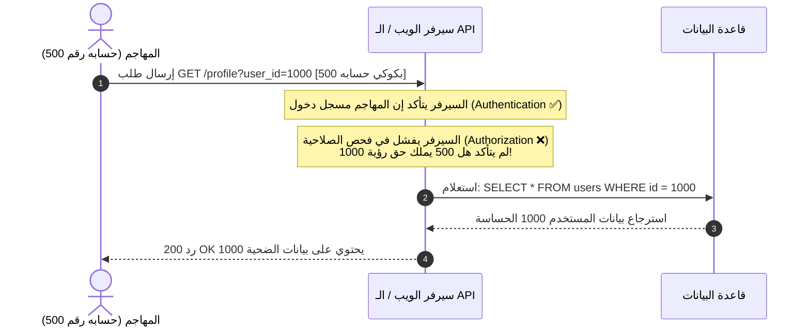
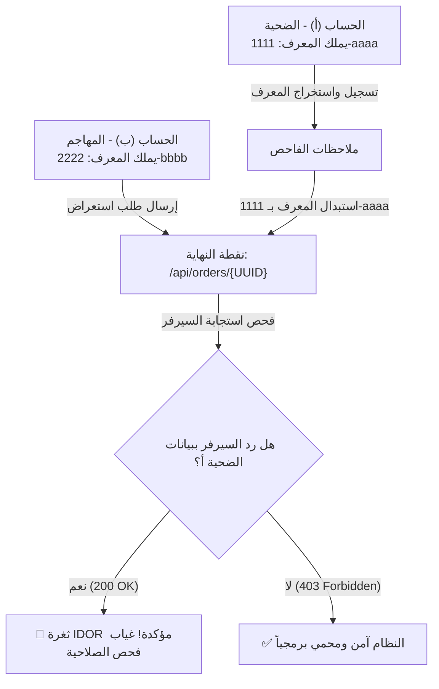

# 🔐 غرفة Insecure Direct Object Reference (IDOR) – TryHackMe

[](https://tryhackme.com/room/idor)
[]()
[]()
[]()

> مرجع دراسي وتطبيقي شامل لغرفة **IDOR** على منصة **TryHackMe**، يركز على الفهم العميق لآلية الثغرة، وكيفية التعامل مع مختلف أشكال المعرفات (Plaintext, Encoded, Hashed, Unpredictable)، ومنهجية الفحص بحسابين، وصولاً إلى الحل العملي وإغلاق الثغرة برمجياً.

---

## 🎯 نظرة عامة على الغرفة والأهداف التعليمية

تحدث ثغرة **IDOR (Insecure Direct Object Reference)** عندما يعتمد التطبيق على معرّف يرسله المستخدم (مثل رقم حساب أو اسم ملف في قاعدة البيانات)، ويقوم السيرفر بجلب هذا الكائن مباشرة دون التحقق مما إذا كان المستخدم صاحب الجلسة الحالية يملك صلاحية الوصول إليه أم لا.

تُصنف الثغرة كواحدة من صور **Broken Access Control (التحكم المكسور في الوصول)** وتأتي على رأس قائمة **OWASP Top 10 (A01:2021)**، كما تُعرف في أمان الـ APIs باسم **BOLA (Broken Object Level Authorization)** في المرتبة الأولى لقائمة **OWASP API Security Top 10**.

### ما الذي ستتعلمه في هذه الغرفة؟
1. فهم ماهية ثغرة IDOR وكيف تنهار طبقة التحقق من الصلاحيات (Authorization) رغم نجاح تسجيل الدخول (Authentication).
2. التعرف على صور المعرفات المختلفة: الصريحة، المرمزة (Encoded)، الهاش (Hashed)، وغير المتوقعة (UUIDs).
3. إتقان **منهجية الفحص بحسابين (Two-Account Technique)** لكشف الثغرة حتى عندما تكون المعرفات عشوائية ومعقدة.
4. اكتشاف متجهات الـ IDOR المخفية خلف الكواليس (طلبات AJAX، ملفات الـ JS، وتقنية Parameter Mining).
5. استغلال الثغرة عملياً لاستخراج بيانات المستخدمين الآخرين.

---

## 📘 Task 1 – ما هي ثغرة IDOR؟ (What is an IDOR?)

### الفكرة والآلية
تعتمد تطبيقات الويب على معرّفات (Identifiers) لتمييز الكائنات والموارد المختلفة؛ فمثلاً لكل ملف شخصي معرّف (`user_id=105`)، ولكل فاتورة رقم (`invoice_id=980`)، ولكل رسالة كود خاص. 

عندما يسمح التطبيق للعميل (المستخدم) بإرسال هذا المعرّف، ويقوم السيرفر بجلب بيانات الكائن المطلوب **دون أن يسأل نفسه: "هل هذا المستخدم يملك حق رؤية هذا الكائن؟"**، تكون ثغرة IDOR حاضرة.



### الفارق بين بساطة الاستغلال وفداحة الأثر
- **سهولة التنفيذ:** لا يحتاج المهاجم لأي برمجيات معقدة أو ثغرات حقن (Injection)؛ في كثير من الأحيان يكفي تغيير رقم في شريط العنوان أو في الـ Request.
- **عظم التأثير:** قد تؤدي الثغرة إلى تسريب كامل لقاعدة بيانات العملاء، أو الاستيلاء الكامل على الحسابات في حال كان الـ Endpoint يسمح بالتعديل (Write/Update) كإعادة تعيين كلمة المرور أو تغيير البريد الإلكتروني.

| السؤال | الإجابة |
|---|---|
| What does IDOR stand for? | `Insecure Direct Object Reference` |

---

## 📗 Task 2 – مثال تطبيقي لثغرة IDOR (An IDOR Example)

### ثغرات القراءة (Read) مقابل ثغرات التعديل (Write)
لو افترضنا أنك سجلت في خدمة وسحبت رابط ملفك الشخصي:
```http
GET /profile?user_id=1305 HTTP/1.1
Host: online-service.thm
```
إذا قمت بتغيير `user_id=1305` إلى `user_id=1000` وظهرت لك بيانات مستخدم آخر، فهذه ثغرة **Read IDOR** (تسريب بيانات).

أما الكارثة الأكبر فتحدث عندما تكون الثغرة في نقاط التعديل أو الحذف (Write / State-Changing Endpoints):
```http
POST /api/user/update-email HTTP/1.1
Host: online-service.thm
Content-Type: application/json

{
  "user_id": 1000,
  "email": "attacker@evil.com"
}
```
إذا غيّر السيرفر بريد المستخدم 1000 دون مطابقة `user_id` مع المستخدم صاحب الجلسة، يستطيع المهاجم طلب إعادة تعيين كلمة المرور لحساب الضحية والاستيلاء عليه بالكامل (**Account Takeover**).

### خطوات حل تدريب Task 2:
1. اضغط على زر **View Site** لفتح الموقع التجريبي داخل المتصفح.
2. تصفح الموقع ولاحظ الرابط أو البارامتر الذي يحمل المعرف الرقمي الخاص بحسابك.
3. قم بتعديل المعرف الرقمي لرقم مستخدم آخر.
4. ستظهر لك بيانات المستخدم الآخر متضمنة الـ Flag المطلوب.

| السؤال | الإجابة |
|---|---|
| What is the Flag from the IDOR example website? | `THM{IDOR-VULN-FOUND}` |

---

## 📙 Task 3 – كشف الـ IDOR في المعرفات المرمزة (Encoded IDs)

لا تعرض جميع التطبيقات المعرفات كنصوص أو أرقام صريحة (Plaintext). يلجأ المطورون أحياناً إلى **ترميز المعرفات (Encoding)** باستخدام **Base64** لضمان نقلها بأمان عبر الـ HTTP دون مشاكل في الحروف الخاصة.

- الرقم `123` بالترميز يصبح: `MTIz`
- كائن JSON مثل `{"user_id": 5}` يصبح: `eyJ1c2VyX2lkIjogNX0=`

> [!WARNING]
> **الترميز ليس تشفيراً (Encoding is NOT Encryption):**
> خوارزمية Base64 هي مجرد تحويل شكلي للبيانات يمكن عكسه وفكه فوراً من قِبل أي شخص. الاعتماد على Base64 لإخفاء الـ ID دون فحص الصلاحية في السيرفر يعادل ترك المعرف صريحاً تماماً.

### دورة الاستغلال الرباعية (4-Step Workflow):
1. **فك الترميز (Decode):** التقط الطلب وفك تشفير القيمة عبر أدوات مثل `CyberChef` أو الطرفية:
   ```bash
   echo "eyJ1c2VyX2lkIjogNX0=" | base64 -d
   # الناتج: {"user_id": 5}
   ```
2. **التعديل (Modify):** تغيير المعرف للضحية المستهدفة (مثلاً من 5 إلى 1):
   ```json
   {"user_id": 1}
   ```
3. **إعادة الترميز (Re-encode):** إعادة تشفير النص المعدل إلى Base64:
   ```bash
   echo -n '{"user_id": 1}' | base64
   # الناتج: eyJ1c2VyX2lkIjogMX0=
   ```
4. **الإرسال (Replay):** استبدال القيمة المشفرة في الطلب وإرساله للسيرفر وفحص النتيجة.

| السؤال | الإجابة |
|---|---|
| What is a common type of encoding used by websites? | `base64` |

---

## 📕 Task 4 – كشف الـ IDOR في المعرفات المهشّرة (Hashed IDs)

تقوم بعض التطبيقات بتمرير المعرفات عبر دوال تجزئة (Cryptographic Hash Functions) مثل **MD5** أو **SHA-1**:
- المستخدم `1` ➔ الهاش: `c4ca4238a0b923820dcc509a6f75849b`
- المستخدم `123` ➔ الهاش: `202cb962ac59075b964b07152d234b70`

### لماذا تفشل هذه الحيلة؟ (The Predictability Flaw)
صحيح أن الهاش دالة أحادية الاتجاه (One-way Function) لا يمكن عكسها رياضياً، إلا أن مدخلاتها هنا **قيم بسيطة ومتوقعة جداً** (أرقام متسلسلة 1، 2، 3...).
- **جداول البحث الجاهزة (Lookup / Rainbow Tables):** مواقع مثل `CrackStation` تكشف هاش الأرقام والكلمات القصيرة في جزء من الثانية.
- **التوليد المحلي:** يستطيع المهاجم كتابة سكريبت صغير يولد هاش الـ MD5 للأرقام من 1 إلى 1000 ويرسلها تباعاً.

### كيفية كشف نوع الهاش:
- طول 32 حرف سداسي عشري (Hex): غالباً **MD5**.
- طول 40 حرف: غالباً **SHA-1**.
- طول 64 حرف: غالباً **SHA-256**.
- باستخدام أدوات كالي لينكس:
  ```bash
  hash-identifier "202cb962ac59075b964b07152d234b70"
  hashid "202cb962ac59075b964b07152d234b70"
  ```

| السؤال | الإجابة |
|---|---|
| What is a common algorithm used for hashing IDs? | `md5` |

---

## 📓 Task 5 – كشف الـ IDOR في المعرفات غير المتوقعة (Unpredictable IDs / UUIDs)

تستخدم بعض التطبيقات الحديثة معرفات عشوائية مستحيلة التخمين مثل **UUID / GUID**:
`d3b07384-d9a0-4e9b-8b3c-2f1a6c7e4a90`

### المعرف المعقد لا يعني الأمان (UUID != Access Control)
المعرف العشوائي يمنع هجوم التخمين والتعداد المتسلسل (Brute Force / Enumeration)، لكنه **لا يحل مشكلة الصلاحيات أبداً**. إذا كان السيرفر لا يفحص هل المستخدم يملك هذا الـ UUID، فبمجرد حصول المهاجم على الـ UUID للضحية، سيتمكن من سرقة بياناته بالكامل.

### منهجية الفحص بحسابين (The Two-Account Technique):
تعتبر هذه التقنية المعيار الذهبي في اختبارات الاختراق لكشف ثغرات الـ IDOR:
1. أنشئ حسابين في التطبيق: **الحساب (أ)** وهو الضحية، و **الحساب (ب)** وهو المهاجم.
2. سجّل الدخول بحساب الضحية (أ)، واستخرج معرف الكائن الخاص به (سواء كان UUID لملفه أو لطلبيته).
3. سجّل الدخول بحساب المهاجم (ب)، واعترض طلب تعديل أو عرض كائن تابع للمهاجم (ب).
4. استبدل معرّف المهاجم بـ معرّف الضحية (أ) المسجل في الخطوة 2.
5. إذا وافق السيرفر وأعاد بيانات الضحية (أ)، فالثغرة مؤكدة وتعتمد على انهيار فحص الصلاحية.



### من أين تتسرب الـ UUIDs للضحايا في الواقع؟
- ملفات الـ JavaScript الخاصة بالتطبيق.
- ردود الـ API التي تذكر أسماء المستخدمين ومعرفاتهم (User Lists / Comments).
- الروابط المشاركة وتقارير الـ CSV المصدرة.
- إشعارات البريد الإلكتروني.

| السؤال | الإجابة |
|---|---|
| What is the minimum number of accounts you need to create to check for IDORs between accounts? | `2` |

---

## 📒 Task 6 – أين تختبئ متجهات الـ IDOR؟ (Where are IDORs located?)

لا تقتصر ثغرات الـ IDOR على المعرفات الظاهرة في شريط عنوان المتصفح (Address Bar). الفاحص المحترف يراقب كل القنوات التالية:

1. **الطلبات الخلفية (Background AJAX / Fetch Requests):**
   - تطبيقات الويب الحديثة (React, Vue, Angular) ترسل طلبات غير مرئية في الخلفية لجلب البيانات عند فتح الصفحة (مثلاً `/api/v1/customer?id=15`).
2. **ملفات الجافاسكريبت (JavaScript Files):**
   - قراءة ملفات الـ `.js` تكشف عن مسارات API وبارامترات غير معلنة في واجهة المستخدم.
3. **التنقيب عن البارامترات (Parameter Mining):**
   - أحياناً يكون الـ Endpoint مصمماً ليعتمد على الكوكي، لكن المطور ترك بارامتر تجريبي لم يحذفه (مثلاً إضافة `?user_id=1` إلى الرابط تجعل السيرفر يفضله على الكوكي).
4. **أماكن أخرى في الـ HTTP Traffic:**
   - **محتوى الـ POST Body:** في حقول JSON أو XML (`{"account_id": 40}`).
   - **رؤوس الطلب (HTTP Headers):** مثل `X-User-Id` أو `X-Forwarded-User`.
   - **أجزاء مسار الـ REST:** مثل `/api/v2/users/89/invoices`.

| السؤال | الإجابة |
|---|---|
| Read the above. | `No answer needed` |

---

## 🔬 Task 7 – المختبر العملي خطوة بخطوة (A Practical IDOR Example)

### سيناريو المعمل التطبيقي:
هدف المعمل هو رصد نقطة نهاية (API Endpoint) تعتمد على معرّف رقمي في الخلفية، والتلاعب بها لاستخراج بيانات المستخدمين الآخرين.

#### الخطوة 1: تجهيز المعمل والحساب
1. اضغط على **Start Lab Machine** وافتح الرابط الناتج في المتصفح:
   `https://LAB_WEB_URL.p.thmlabs.com`
2. ادخل على قسم **Customers** وسجل حساباً جديداً باسم وكلمة مرور من اختيارك.
3. بعد تسجيل الدخول، توجه إلى صفحة **Your Account**.

#### الخطوة 2: مراقبة الترافيك واكتشاف الـ Endpoint
1. افتح أدوات المطور في المتصفح بالضغط على **F12**، ثم اختر تبويب **Network**.
2. أعد تحميل الصفحة، ولاحظ الطلبات التي يرسلها المتصفح في الخلفية.
3. ستجد طلباً لـ API بهذا الشكل:
   ```http
   GET /api/v1/customer?id={user_id} HTTP/1.1
   Host: LAB_WEB_URL.p.thmlabs.com
   Accept: application/json
   ```
4. اضغط على الطلب وتفحص الرد (Response)، ستجد كائن JSON يحتوي على:
   ```json
   {
     "id": 15,
     "username": "your_user",
     "email": "your_email@domain.com"
   }
   ```
   هنا السيرفر يحدد المستخدم المعروض بناءً على بارامتر `id` في الرابط مباشرة دون التحقق من الجلسة!

#### الخطوة 3: التلاعب بالمعرف واستخراج البيانات المطلوبة
اضغط كليك يمين على الطلب في تبويب Network واختر **Edit and Resend** (أو أرسله إلى **Burp Suite Repeater**):

1. **استخراج بيانات المستخدم رقم 1:**
   - عدّل الطلب إلى: `/api/v1/customer?id=1` وأرسله.
   - رد السيرفر:
     ```json
     {
       "id": 1,
       "username": "adam84",
       "email": "adam84@fakemail.thm"
     }
     ```
   - **اسم مستخدم المستخدم رقم 1:** `adam84`

2. **استخراج بيانات المستخدم رقم 3:**
   - عدّل الطلب إلى: `/api/v1/customer?id=3` وأرسله.
   - رد السيرفر:
     ```json
     {
       "id": 3,
       "username": "j_user",
       "email": "j@fakemail.thm"
     }
     ```
   - **البريد الإلكتروني للمستخدم رقم 3:** `j@fakemail.thm`

| السؤال | الإجابة |
|---|---|
| What is the username for user id 1? | `adam84` |
| What is the email address for user id 3? | `j@fakemail.thm` |

---

## 🛡️ أسباب الثغرة وطرق الحماية البرمجية للمطورين

### 🔴 السبب الجذري في الكود (The Root Cause):
الخطأ الأساسي هو ثقة الكود في البارامتر القادم من العميل والبحث به مباشرة في قاعدة البيانات:
```php
// كود مصاب: يعتمد كلياً على مدخلات العميل دون التحقق من ملكية الجلسة
$id = $_GET['id'];
$stmt = $pdo->prepare('SELECT * FROM customers WHERE id = :id');
$stmt->execute(['id' => $id]);
$customer = $stmt->fetch();
echo json_encode($customer);
```

### 🟢 الحل البرمجي الصحيح (Secure Remediation):

#### 1. ربط الاستعلام بالجلسة المسجلة في السيرفر (Session Binding):
```php
session_start();
if (!isset($_SESSION['user_id'])) {
    http_response_code(401);
    die(json_encode(['error' => 'يجب تسجيل الدخول']));
}

$session_user_id = $_SESSION['user_id'];
$requested_id = $_GET['id'];

// التأكد من أن المستخدم يطلب بياناته فقط، إلا إذا كان مسؤولاً (Admin)
if ($session_user_id != $requested_id && !$_SESSION['is_admin']) {
    http_response_code(403);
    die(json_encode(['error' => 'غير مصرح لك بالوصول لهذا المورد']));
}

// تنفيذ الاستعلام بأمان
$stmt = $pdo->prepare('SELECT id, username, email FROM customers WHERE id = :id');
$stmt->execute(['id' => $requested_id]);
$customer = $stmt->fetch();
echo json_encode($customer);
```

#### 2. استخدام مراجع غير مباشرة (Indirect Reference Maps):
بدلاً من كشف المعرف الحقيقي لقاعدة البيانات، يتم توليد مراجع مؤقتة خاصة بكل جلسة (Session-scoped indices) يتم تخزينها في الـ Session، بحيث لا تعني الأرقام أي شيء خارج جلسة المستخدم الحالية.
