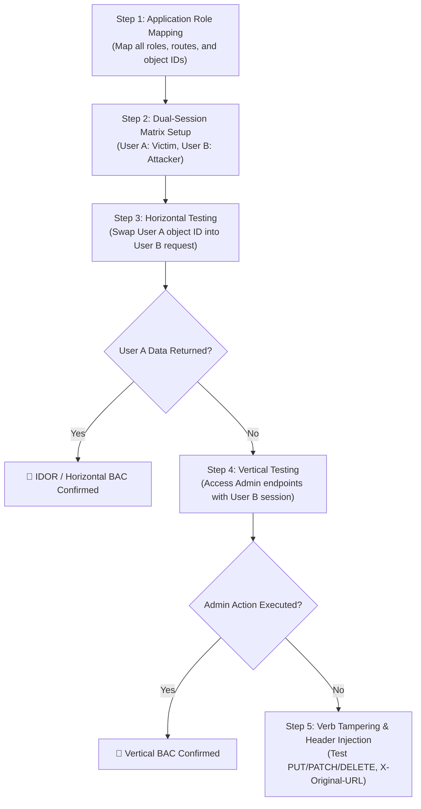

# Broken Access Control & IDOR — HAXMED Intelligence Reference

[]()
[]()
[]()
[]()

---

## 1. Overview

**Broken Access Control (BAC)** encompasses flaws where an application fails to properly enforce restrictions on what authenticated or unauthenticated users are allowed to do. Users can act outside of their intended permissions, leading to unauthorized information disclosure, modification or destruction of data, or performing business functions outside the user's limits.

- **Primary Classification:** OWASP Top 10:2021 — #1 **A01:2021-Broken Access Control**; OWASP API Security Top 10:2023 — #1 **API1:2023-Broken Object Level Authorization (BOLA)** and #5 **API5:2023-Broken Function Level Authorization (BFLA)**.
- **Common Aliases:** Insecure Direct Object References (IDOR), Privilege Escalation (Horizontal/Vertical), Missing Function Level Access Control, Forced Browsing, Contextual Authorization Bypass.
- **CWE Mappings:**
  - `CWE-284`: Improper Access Control
  - `CWE-285`: Improper Authorization
  - `CWE-639`: Authorization Bypass Through User-Controlled Key (IDOR)
  - `CWE-862`: Missing Authorization
  - `CWE-863`: Incorrect Authorization
- **Security Impact:** Confidentiality loss (mass personal identifiable information exfiltration), Integrity violation (unauthorized editing/deletion of records, balance manipulation), and Complete Account Takeover (modifying email/password reset flows).

---

## 2. Root Cause and Attack Surface

### Root Cause
1. **Confusing Authentication with Authorization:** Assuming that verifying *who* a user is (valid session token or JWT) automatically justifies granting access to whatever resource key they request.
2. **Client-Side Security Posture:** Hiding UI buttons, navigation links, or admin tabs via CSS/JavaScript (`display: none`) while leaving backend endpoints unvalidated.
3. **Implicit Trust in Client Identifiers:** Utilizing query parameters (`?user_id=12`), POST body fields, or cookies without binding access to server-managed session state.
4. **Decentralized Authorization Logic:** Dispersing permission checks across controllers ad-hoc rather than enforcing unified declarative security filters or middleware.

### Attack Surface Entry Points
- **URL Parameters & REST Path Segments:** `/api/v1/users/{id}`, `/invoices/{invoice_id}`, `/documents/download?id=108`.
- **HTTP Request Headers:** Custom role headers (`X-User-Role: admin`, `X-Original-URL: /admin`, `X-Rewrite-URL: /admin`).
- **HTTP Verb Tampering:** Bypassing security constraints applied exclusively to `GET` by submitting requests as `POST`, `PUT`, `PATCH`, or `HEAD`.
- **JSON / Form Request Bodies:** Parameter pollution or mass assignment (`{"role": "admin"}`, `{"account_id": 99}`).
- **Static Artifacts & Backup Endpoints:** Predictable chat transcripts (`/download-transcript/1.txt`), order confirmation receipts (`/receipts/2026-0001.pdf`).

---

## 3. Detection and Reconnaissance

### Signs of Susceptibility
- Sequential integer IDs in URLs or API calls (`?id=1001`, `?id=1002`).
- Base64-encoded strings terminating with `=` that decode to numeric IDs or JSON strings (`MTIz` ➔ `123`).
- Hashes matching 32 hex characters (MD5) or 40 hex characters (SHA1) generated from sequential numbers.
- Endpoints serving identical responses when stripping authorization tokens or swapping cookies.

### Testing Mindset & Inspection Points
1. **Traffic Analysis via Proxy:** Monitor all background XHR/Fetch requests in Burp Suite / OWASP ZAP.
2. **The Multi-Account Matrix:** Maintain at least three active sessions:
   - Account A (Standard User 1 — Victim)
   - Account B (Standard User 2 — Attacker)
   - Account C (Administrative User — Reference for privilege boundaries)
3. **Parameter Mining:** Fuzz endpoints using tools like `Param Miner` to uncover hidden parameters (`user_id`, `admin`, `debug`, `role`).

---

## 4. Testing Methodology



1. **Reconnaissance:** Enumerate all functional endpoints for each privilege tier.
2. **Baseline Collection:** Capture valid requests for Account A (resource owner) and note status codes, response length, and content.
3. **Parameter Substitution:** Replay the exact request using Account B's session tokens while pointing to Account A's object references.
4. **Header Manipulation:** Test reverse proxy headers (`X-Original-URL`, `X-Rewrite-URL`, `X-Forwarded-For`).
5. **Verb Alternation:** Change `GET` requests to `POST`, `OPTIONS`, `PUT`, or arbitrary HTTP methods.

---

## 5. Payload Library

> [!NOTE]
> All payloads below are designed for non-destructive verification in authorized testing environments.

### BAC-PL-01: Direct Integer Identifier Swap
- **Payload:** `GET /api/user/profile?user_id=1001` ➔ `GET /api/user/profile?user_id=1000`
- **Purpose:** Horizontal privilege verification.
- **Context:** REST API query strings or JSON request bodies.
- **Expected Behavior:** Response reflects Target User (1000) data instead of requester's profile.
- **Prerequisites:** Two registered test accounts.
- **Classification:** `[CONFIRMED]`

### BAC-PL-02: Base64 Decoded Identifier Manipulation
- **Payload:** Raw: `MTIz` (`123`) ➔ Altered: `MTIy` (`122`)
- **Purpose:** Test whether encoded object references are validated server-side.
- **Context:** Cookie values or encoded parameters.
- **Expected Behavior:** Server decodes `122` and serves records belonging to user 122.
- **Classification:** `[CONFIRMED]`

### BAC-PL-03: Reverse Proxy Header Override (X-Original-URL)
- **Payload:**
  ```http
  GET / HTTP/1.1
  Host: target.local
  X-Original-URL: /admin/delete?username=carlos
  ```
- **Purpose:** Bypass front-end reverse proxy URL filtering where backend frameworks trust routing overrides.
- **Context:** Environments using front-end proxies (Nginx/HAProxy) in front of frameworks like Symfony, Spring, or ASP.NET.
- **Classification:** `[CONFIRMED]`

### BAC-PL-04: HTTP Verb Tampering
- **Payload:** Alter `POST /admin/roles` to `GET /admin/roles` or `PUT /admin/roles`
- **Purpose:** Bypass verb-specific authorization filters (e.g., Spring Security `<intercept-url method="POST">`).
- **Context:** Administrative state-changing actions.
- **Classification:** `[CONFIRMED]`

### BAC-PL-05: Referer Header Spoofing
- **Payload:**
  ```http
  GET /admin/delete-user?id=5 HTTP/1.1
  Host: target.local
  Referer: https://target.local/admin/panel
  ```
- **Purpose:** Test whether authorization logic naively validates only the `Referer` header to grant administrative execution.
- **Classification:** `[LAB-ONLY]`

---

## 6. Bypass Techniques

### 1. Reverse Proxy Routing Differences
- **Mechanism:** Front-end reverse proxies enforce access control rules based on requested URLs. However, web servers or application runtimes might accept override headers (`X-Original-URL`, `X-Rewrite-URL`).
- **Preconditions:** Mismatch between front-end routing rules and backend handler routing.
- **Failure Conditions:** Modern frameworks with strict reverse proxy configurations ignore or strip unauthenticated routing headers.

### 2. Method-Based Filter Evasion
- **Mechanism:** Web.xml or security decorators configured with `<http-method>POST</http-method>` block unprivileged POST requests. Supplying the same parameters via `GET` or `HEAD` circumvents the security filter if the backend controller handles all verbs.
- **Verification:** Compare HTTP status codes (403 Forbidden on POST vs 200 OK on GET/POST).

### 3. Workflow Step Jumping
- **Mechanism:** Multi-step business processes (e.g., Step 1: Select Plan ➔ Step 2: Payment ➔ Step 3: Confirmation & Activation) validate authorization only at Step 1 or Step 2. An attacker jumps directly to Step 3 (`/activate?orderId=...`).

---

## 7. Exploit and PoC References

- **CVE-2021-41773 & CVE-2021-42013:** Apache HTTP Server path traversal and access control bypass due to path normalization failures.
- **OWASP BOLA Case Studies:** Documented incidents where mobile ride-sharing apps allowed scraping passenger ride histories by swapping trip IDs in JSON payloads.
- **Kubernetes API Server Bypass (CVE-2018-1002105):** Privilege escalation through proxy request handling flaws allowing arbitrary command injection into pods.

---

## 8. Tools and Automation

1. **Autorize (Burp Suite Extension):**
   - **Repository:** `https://github.com/Quitten/Autorize`
   - **Purpose:** Automatically repeats every browser request with a low-privileged session cookie and an unauthenticated cookie to flag authorization anomalies in real time.
2. **AutoRepeater:**
   - **Repository:** `https://github.com/nccgroup/AutoRepeater`
   - **Purpose:** Automated conditional request replacement and logging.
3. **Param Miner:**
   - **Repository:** `https://github.com/PortSwigger/param-miner`
   - **Purpose:** Discovers hidden parameters, unlinked headers, and secret routing flags.

---

## 9. Troubleshooting and False Positives

- **Misleading 200 OK Responses:** Many Single-Page Applications return `200 OK` with an empty JSON object `{}` or a generic redirect script when an unauthorized request occurs. Always verify the presence of actual target data in the response body.
- **CSRF Token Invalidation:** If substituting session tokens causes `403 Forbidden`, ensure CSRF tokens tied to the session are also synchronized; otherwise, the block may be due to CSRF protection, not access control.
- **Static Asset Caching:** Front-end CDN caches might return cached static responses rather than dynamic data, giving the false impression of an authorization leak.

---

## 10. Remediation and Retesting

### Secure Implementation Pattern (PHP / Laravel / Node.js)
Bind queries directly to the authenticated session context. Never query solely by a user-supplied key:

```php
// SECURE: Enforces resource ownership at the data layer
session_start();
if (!isset($_SESSION['user_id'])) {
    http_response_code(401);
    exit(json_encode(['error' => 'Authentication required']));
}

$user_id = $_SESSION['user_id'];
$account_id = $_GET['account_id'];

// Bind query to both target resource AND owner session ID
$stmt = $pdo->prepare('SELECT * FROM accounts WHERE id = :account_id AND owner_id = :user_id');
$stmt->execute(['account_id' => $account_id, 'user_id' => $user_id]);
$account = $stmt->fetch();

if (!$account) {
    http_response_code(404);
    exit(json_encode(['error' => 'Resource not found or unauthorized']));
}
```

### Verification Checklist:
- [ ] Deny by default: Ensure endpoints require authentication unless explicitly declared public.
- [ ] Centralize authorization middleware on all routes (REST, GraphQL, WebSocket).
- [ ] Use Indirect Reference Maps or cryptographically secure GUIDs where applicable.
- [ ] Log and monitor repeated 403 Forbidden responses for access control fuzzing detection.

---

## 11. PortSwigger / TryHackMe / OWASP Lab Mapping

| Lab / Room Name | Platform | Focus Area | Directory Reference |
|---|---|---|---|
| Unprotected Admin Functionality | PortSwigger | Vertical BAC (Unrestricted URL) | [Lab-01](./EN/Lab-01-Unprotected-Admin-Functionality.md) |
| Unprotected Admin with Unpredictable URL | PortSwigger | Information Leakage in JS | [Lab-02](./EN/Lab-02-Unprotected-Admin-Functionality-with-Unpredictable-URL.md) |
| User Role Controlled by Request Parameter | PortSwigger | Cookie Role Forgery | [Lab-03](./EN/Lab-03-User-Role-Controlled-by-Request-Parameter.md) |
| User Role Can Be Modified in User Profile | PortSwigger | Mass Assignment Privilege Escalation | [Lab-04](./EN/Lab-04-User-Role-Can-Be-Modified-in-User-Profile.md) |
| User ID Controlled by Request Parameter | PortSwigger | Classic Horizontal IDOR | [Lab-05](./EN/Lab-05-User-ID-Controlled-by-Request-Parameter.md) |
| User ID with Unpredictable IDs | PortSwigger | IDOR + GUID Information Leak | [Lab-06](./EN/Lab-06-User-ID-Controlled-by-Request-Parameter-with-Unpredictable-User-IDs.md) |
| User ID with Data Leakage in Redirect | PortSwigger | 302 Body Disclosure | [Lab-07](./EN/Lab-07-User-ID-Controlled-by-Request-Parameter-with-Data-Leakage-in-Redirect.md) |
| User ID with Password Disclosure | PortSwigger | Horizontal to Vertical Chain | [Lab-08](./EN/Lab-08-User-ID-Controlled-by-Request-Parameter-with-Password-Disclosure.md) |
| Static File IDOR (Chat Transcripts) | PortSwigger | Predictable Static File Paths | [Lab-09](./EN/Lab-09-Insecure-Direct-Object-References-(Predictable-Static-Files).md) |
| URL-based Access Control Bypass | PortSwigger | `X-Original-URL` Proxy Bypass | [Lab-10](./EN/Lab-10-URL-based-Access-Control-Can-Be-Circumvented.md) |
| Method-based Access Control Bypass | PortSwigger | HTTP Method Tampering | [Lab-11](./EN/Lab-11-Method-based-Access-Control-Can-Be-Circumvented.md) |
| Multi-step Process Access Control Flaw | PortSwigger | Workflow Step Skipping | [Lab-12](./EN/Lab-12-Multi-step-Process-with-No-Access-Control-on-One-Step.md) |
| Referer-based Access Control | PortSwigger | Trust in Client Referer Header | [Lab-13](./EN/Lab-13-Referer-based-Access-Control.md) |
| Broken Access Control Room | TryHackMe | Fundamental BAC Models & Roles | [THM Guide](./EN/THM-Broken-Access-Control.md) |
| IDOR Room | TryHackMe | Encoded, Hashed & Unpredictable IDs | [THM Guide](./EN/THM-IDOR.md) |

---

## 12. Reporting Guidance

- **Vulnerability Title:** Insecure Direct Object Reference (IDOR) Leading to Unauthorized Data Access / Privilege Escalation.
- **Severity Rating:** High to Critical (CVSS v3.1 Base Score: 7.5 - 9.1).
  - *Vector Example:* `CVSS:3.1/AV:N/AC:L/PR:L/UI:N/S:U/C:H/I:H/A:N`
- **Executive Summary:** During the security assessment, it was discovered that the application does not properly validate whether the authenticated user possesses authorization to access requested records. By altering numeric resource identifiers, an attacker can access confidential records belonging to other users.
- **Remediation Recommendation:** Enforce authorization checks at the backend controller and database access layers using session-scoped ownership verification.

---

## 13. References

- **OWASP Top 10 A01:2021:** https://owasp.org/Top10/A01_2021-Broken_Access_Control/
- **OWASP API Security Top 10 BOLA:** https://owasp.org/API-Security/editions/2023/en/0xa1-broken-object-level-authorization/
- **PortSwigger Web Security Academy Access Control:** https://portswigger.net/web-security/access-control
- **CWE-639 (Insecure Direct Object Reference):** https://cwe.mitre.org/data/definitions/639.html
- **CWE-284 (Improper Access Control):** https://cwe.mitre.org/data/definitions/284.html

---

## 14. Research Coverage and Validation Status

| Metric | Status / Count |
|---|---|
| Total Lab References Verified | 15 (13 PortSwigger + 2 TryHackMe) |
| Verification Status | `[CONFIRMED]` across all documented lab targets |
| Limitations | Reverse proxy bypass headers (`X-Original-URL`) depend on front-end server routing implementations. |
