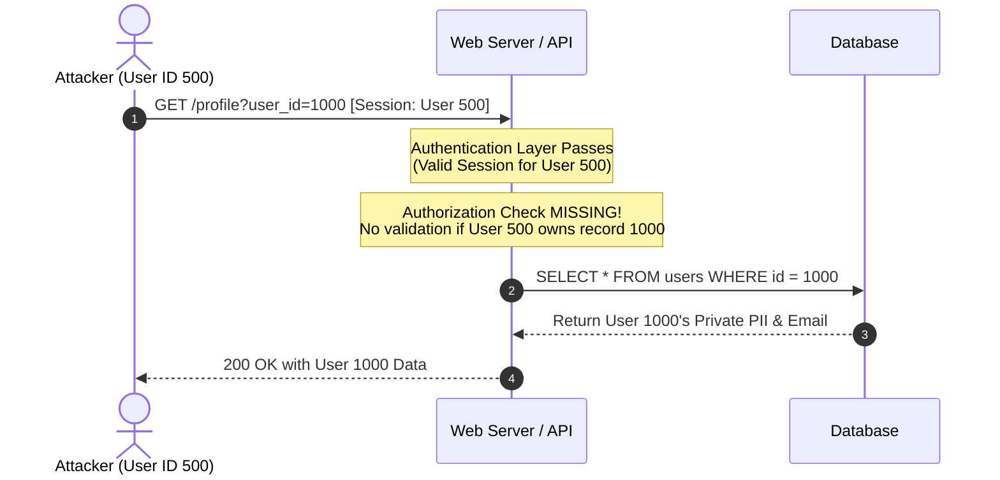
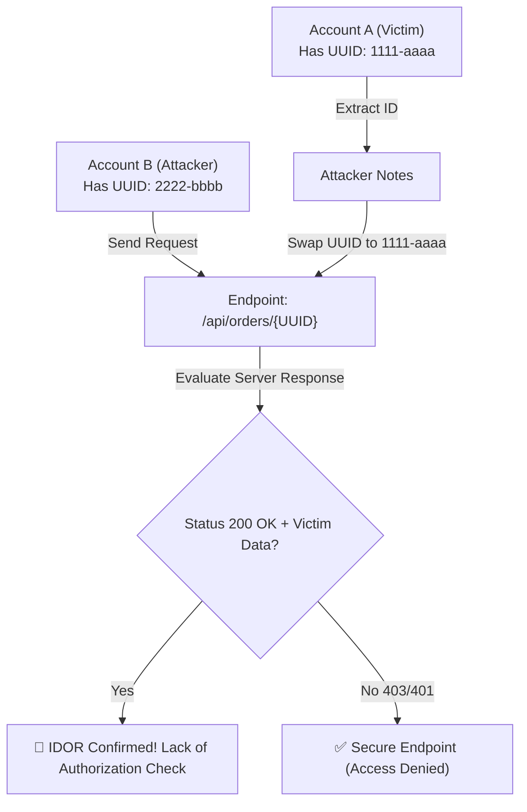

# TryHackMe — Insecure Direct Object Reference (IDOR) Study Guide

[](https://tryhackme.com/room/idor)
[]()
[]()
[]()

This study guide provides an in-depth walkthrough of the **Insecure Direct Object Reference (IDOR)** room on TryHackMe. It analyzes the underlying mechanics, identification techniques across various identifier representations, testing methodologies, and secure development remediation.

---

## 🎯 Room Overview & Objectives

Insecure Direct Object Reference (IDOR) occurs when an application exposes a reference to an internal implementation object (such as a database record, file, or key) in a request and trusts the client-supplied value without verifying that the requesting user is authorized to access that object.

### Learning Goals:
- Understand how IDOR fits into **OWASP Top 10 A01:2021 (Broken Access Control)** and **OWASP API Security Top 10 (BOLA - Broken Object Level Authorization)**.
- Recognize different identifier representations: **Plaintext**, **Encoded (Base64)**, **Hashed (MD5/SHA)**, and **Unpredictable (UUID/GUID)**.
- Master the **Two-Account Testing Methodology** to uncover authorization bypasses even when identifiers cannot be enumerated.
- Identify hidden IDOR injection points beyond standard URL parameters (Background AJAX/XHR requests, JS files, Parameter Mining).
- Execute practical exploitation workflows using DevTools, Burp Suite Repeater, and curl.

---

## 📘 Task 1: What is an IDOR?

### The Mechanics
Web applications rely on identifiers to distinguish one resource from another. Whether it is an invoice (`/invoice?id=104`), a profile record (`/user/1305`), or a private document (`/download?file=statement_882.pdf`), the server uses these keys internally to locate records in its database or filesystem.

When the application blindly trusts the user-supplied identifier without performing an authorization check against the user's active session, an **Insecure Direct Object Reference (IDOR)** exists.



### The Gap Between Simplicity and Impact
- **Low Complexity:** Exploitation rarely requires complex payloads, memory corruption, or bypass chains. It often boils down to incrementing or swapping an integer in an HTTP request.
- **High Severity:** A single vulnerable endpoint can allow an attacker to dump an entire customer database (Horizontal Privilege Escalation) or modify administrative settings and reset other users' passwords (Vertical Privilege Escalation / Account Takeover).

| Question | Answer |
|---|---|
| What does IDOR stand for? | `Insecure Direct Object Reference` |

---

## 📗 Task 2: An IDOR Example

### Read vs. Write IDOR
Consider an endpoint returning user profile information:
```http
GET /profile?user_id=1305 HTTP/1.1
Host: online-service.thm
Cookie: session=attacker_valid_cookie
```

If changing `user_id=1305` to `user_id=1000` returns user 1000's profile, the endpoint suffers from a **Read IDOR** (Information Disclosure).

However, IDOR vulnerabilities are equally destructive on **Write** operations:
```http
POST /api/user/update-email HTTP/1.1
Host: online-service.thm
Content-Type: application/json
Cookie: session=attacker_valid_cookie

{
  "user_id": 1000,
  "email": "attacker@evil.com"
}
```
If the backend updates user 1000's email address to the attacker's email because it relies on the JSON body rather than the session, the attacker can initiate a password reset and achieve **Full Account Takeover**.

### Walkthrough & Flag Retrieval
1. Click **View Site** to launch the interactive simulation.
2. Observe the profile URL or parameter containing an object identifier.
3. Modify the numeric ID parameter to an adjacent integer (e.g., changing your assigned ID to another active user ID).
4. Inspect the returned profile data to obtain the hidden flag.

| Question | Answer |
|---|---|
| What is the Flag from the IDOR example website? | `THM{IDOR-VULN-FOUND}` |

---

## 📙 Task 3: Finding IDORs in Encoded IDs

Developers often encode identifiers before sending them over the wire to ensure ASCII safety, handle special characters, or pass structured metadata.

### Common Encoding: Base64
Base64 uses `[A-Za-z0-9+/]` and `=` padding.
- `123` ➔ `MTIz`
- `{"user_id": 5}` ➔ `eyJ1c2VyX2lkIjogNX0=`

> [!WARNING]
> **Encoding is NOT Encryption**:
> Base64 is a reversible, deterministic data formatting algorithm, not a cryptographic boundary. An application that relies on encoded identifiers without server-side permission checks is just as vulnerable as one using cleartext integers.

### 4-Step Exploitation Workflow:
1. **Decode:** Intercept the request and decode the identifier:
   ```bash
   echo -n "eyJ1c2VyX2lkIjogNX0=" | base64 -d
   # Output: {"user_id": 5}
   ```
2. **Modify:** Change the object reference from `5` to the target ID (e.g., `1`):
   ```json
   {"user_id": 1}
   ```
3. **Re-encode:** Convert the payload back to Base64:
   ```bash
   echo -n '{"user_id": 1}' | base64
   # Output: eyJ1c2VyX2lkIjogMX0=
   ```
4. **Replay:** Replace the parameter value in Burp Suite Repeater or curl and inspect the response.

| Question | Answer |
|---|---|
| What is a common type of encoding used by websites? | `base64` |

---

## 📕 Task 4: Finding IDORs in Hashed IDs

Some web applications apply a cryptographic hash function to identifiers (e.g., MD5, SHA-1, SHA-256) to obscure the underlying sequence:
- User `1` ➔ `c4ca4238a0b923820dcc509a6f75849b` (MD5 of "1")
- User `123` ➔ `202cb962ac59075b964b07152d234b70` (MD5 of "123")

### The Weakness: Predictable Inputs
While hashing is mathematically one-way (irreversible), hashing **predictable, low-entropy values** (such as incremental sequential integers) provides zero security:
- **Precomputed Rainbow Tables:** Services like CrackStation or local wordlists instantly identify hashes of small integers.
- **Client-Side Generation:** If an attacker knows user IDs increment by 1, they can locally compute hashes for `1..1000` in milliseconds and test them against the endpoint.

### Identification Tools
- **Length analysis:**
  - 32 hex characters: MD5
  - 40 hex characters: SHA-1
  - 64 hex characters: SHA-256
- **CLI Utilities:**
  ```bash
  hash-identifier "202cb962ac59075b964b07152d234b70"
  hashid "202cb962ac59075b964b07152d234b70"
  ```

| Question | Answer |
|---|---|
| What is a common algorithm used for hashing IDs? | `md5` |

---

## 📓 Task 5: Finding IDORs in Unpredictable IDs

When an application uses Universally Unique Identifiers (UUIDs) such as `d3b07384-d9a0-4e9b-8b3c-2f1a6c7e4a90`, sequential guessing and mathematical enumeration are impossible.

### UUID != Access Control
An unpredictable ID only defends against **brute-force enumeration**; it does **not** enforce authorization. If the backend fails to verify ownership, any user who obtains another user's UUID can access their data.

### The Two-Account Testing Technique:
1. Register **Account A** (Victim) and **Account B** (Attacker).
2. Log into Account A and map out all resources (Profile UUID, Order GUIDs, Invoice IDs).
3. Log into Account B and intercept a request to view or edit Account B's resource.
4. Replace Account B's UUID with Account A's UUID.
5. If the server fulfills the request and returns Account A's confidential data, an IDOR vulnerability exists.



### Common Leakage Vectors for UUIDs:
- Shared public documents and forum posts
- API responses that reference related records (e.g., order histories listing merchant IDs)
- Client-side JavaScript bundles and DOM comments
- Email notifications and invoice download links

| Question | Answer |
|---|---|
| What is the minimum number of accounts you need to create to check for IDORs between accounts? | `2` |

---

## 📒 Task 6: Where are IDORs Located?

IDORs are not limited to query parameters visible in your browser's address bar. Comprehensive testing requires auditing all client-to-server data channels:

1. **Background Asynchronous Requests (AJAX / Fetch / XHR):**
   - Single-Page Applications (SPAs) load data dynamically via backend REST endpoints.
   - Example: Loading `/dashboard` sends an internal background request to `/api/v1/customer?id=42`.
2. **Client-Side JavaScript Analysis:**
   - Examining `.js` files often reveals unpublished API endpoints, debug routes, or hidden parameters (e.g., `accountId`, `org_id`).
3. **Parameter Mining:**
   - Endpoints might accept undocumented parameters originally created for testing or administrative tools (e.g., adding `?user_id=1` to an endpoint that normally relies only on session cookies).
4. **Other Transport Locations:**
   - **POST/PUT Body:** JSON, XML, or multipart form fields (`{"invoice_id": 994}`).
   - **HTTP Headers:** Custom headers like `X-User-Id` or `X-Account-Context`.
   - **REST Path Segments:** Direct RESTful routes like `/api/v2/companies/88/documents`.

| Question | Answer |
|---|---|
| Read the above. | `No answer needed` |

---

## 🔬 Task 7: A Practical IDOR Example

### Step-by-Step Practical Walkthrough

#### 1. Setup & Registration
1. Start the Lab Machine and open `https://LAB_WEB_URL.p.thmlabs.com` in your browser.
2. Navigate to the **Customers** section and register a new account (e.g., `tester / password123`).
3. Log in and navigate to the **Your Account** tab.

#### 2. Network Reconnaissance
1. Open Browser Developer Tools (**F12** or `Ctrl+Shift+I`) and switch to the **Network** tab.
2. Refresh the page or trigger an update.
3. Locate the background API request:
   ```http
   GET /api/v1/customer?id={your_user_id} HTTP/1.1
   Host: LAB_WEB_URL.p.thmlabs.com
   Accept: application/json
   ```
4. Click on the request and inspect the JSON response:
   ```json
   {
     "id": 15,
     "username": "tester",
     "email": "tester@example.com"
   }
   ```
   Notice that the returned profile is determined entirely by the `id` query parameter!

#### 3. Exploitation via Replay
1. Right-click the request and select **Edit and Resend** (in Firefox), use the **Burp Suite Repeater**, or issue a `curl` request:
   ```bash
   curl -s "https://LAB_WEB_URL.p.thmlabs.com/api/v1/customer?id=1" -H "Cookie: session=<YOUR_SESSION>"
   ```
2. **Target User ID 1:**
   - Request: `/api/v1/customer?id=1`
   - Response:
     ```json
     {
       "id": 1,
       "username": "adam84",
       "email": "adam84@fakemail.thm"
     }
     ```
   - **Username for user id 1:** `adam84`

3. **Target User ID 3:**
   - Request: `/api/v1/customer?id=3`
   - Response:
     ```json
     {
       "id": 3,
       "username": "j_doe",
       "email": "j@fakemail.thm"
     }
     ```
   - **Email address for user id 3:** `j@fakemail.thm`

| Question | Answer |
|---|---|
| What is the username for user id 1? | `adam84` |
| What is the email address for user id 3? | `j@fakemail.thm` |

---

## 🛡️ Root Cause Analysis & Secure Remediation

### The Root Cause
The vulnerability stems from relying on client-controlled input (`?id=X`) to select database records without validating that the authenticated session owns or has permission to view that record.

#### Flawed Implementation (Vulnerable):
```php
// VULNERABLE: Direct lookup based solely on user-supplied parameter
$id = $_GET['id'];
$stmt = $pdo->prepare('SELECT * FROM customers WHERE id = :id');
$stmt->execute(['id' => $id]);
$customer = $stmt->fetch();
echo json_encode($customer);
```

### The Fix: Session-Bound Authorization
Always bind object queries directly to the authenticated session context, or explicitly verify access rights before returning data.

#### Secure Implementation (Remediated):
```php
// SECURE: Server enforces that users can only access their own record
session_start();
if (!isset($_SESSION['user_id'])) {
    http_response_code(401);
    die(json_encode(['error' => 'Authentication required']));
}

$session_user_id = $_SESSION['user_id'];
$requested_id = $_GET['id'];

// Check ownership or role-based privilege
if ($session_user_id != $requested_id && !$_SESSION['is_admin']) {
    http_response_code(403);
    die(json_encode(['error' => 'Forbidden: You do not own this resource']));
}

$stmt = $pdo->prepare('SELECT id, username, email FROM customers WHERE id = :id');
$stmt->execute(['id' => $requested_id]);
$customer = $stmt->fetch();
echo json_encode($customer);
```

### Core Defensive Principles:
1. **Never Trust Client Identifiers:** Do not assume an authenticated user is authorized to touch every ID they submit.
2. **Use Indirect Reference Maps:** Instead of exposing internal database primary keys, map internal objects to temporary session-scoped references (e.g., Index 1, 2, 3 mapped per user session).
3. **Enforce Authorization on All CRUD Operations:** Check permissions for both read (`GET`) and state-changing actions (`POST`, `PUT`, `DELETE`).
