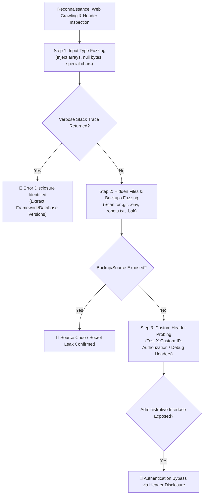

# Information Disclosure — HAXMED Intelligence Reference

[]()
[]()
[]()
[]()

---

## 1. Overview

**Information Disclosure** (also known as Information Leakage) occurs when an application unintentionally exposes sensitive technical, operational, or business data to unauthorized parties. While often categorized as an informational or low-severity finding on its own, it functions as a critical force-multiplier and stepping stone in multi-stage attack chains.

- **Primary Classification:** OWASP Top 10:2021 — **A05:2021-Security Misconfiguration** and **A04:2021-Insecure Design**; CWE-200 (Exposure of Sensitive Information to an Unauthorized Actor).
- **Common Aliases:** Technical Data Leakage, Verbose Error Disclosure, Banner Grabbing, Source Code Exposure via Backup Files, Git Metadata Exposure.
- **CWE Mappings:**
  - `CWE-200`: Exposure of Sensitive Information to an Unauthorized Actor
  - `CWE-209`: Generation of Error Message Containing Sensitive Information
  - `CWE-538`: File and Directory Information Exposure
  - `CWE-548`: Exposure of Information Through Directory Listing
  - `CWE-527`: Exposure of Version-Control Repository to an Unauthorized Control Sphere
- **Security Impact:** Facilitates targeted exploit development by exposing exact framework versions, database schemes, third-party libraries, internal IP addresses, API keys, credentials, and business logic source code.

---

## 2. Root Cause and Attack Surface

### Root Cause
1. **Verbose Error Handling in Production:** Leaving development error reporting (`display_errors = On`, `DEBUG = True`) active, leaking full stack traces and SQL queries.
2. **Insecure Deployment Pipelines:** Leaving hidden version-control folders (`.git`, `.svn`) or temporary editor backups (`.bak`, `.old`, `~`) within public web roots.
3. **Overly Permissive HTTP Headers & Banners:** Advertising exact server, proxy, and runtime versions (`Server: Apache/2.4.41`, `X-Powered-By: PHP/7.4.3`).
4. **Trusting Client-Side Isolation:** Returning sensitive object attributes (passwords, tokens, administrative flags) in API JSON payloads under the assumption that the front-end will filter them out before rendering.

### Attack Surface Entry Points
- **Uncaught Exception Triggers:** Malformed query parameters, type mismatches (sending arrays where strings are expected: `?id[]=1`), or oversized inputs.
- **Common Debug & Diagnostic Routes:** `/debug`, `/trace`, `/actuator`, `/actuator/env`, `/phpinfo.php`, `/elmah.axd`.
- **Publicly Accessible Hidden Artifacts:** `/.git/HEAD`, `/.git/index`, `/.env`, `/web.config.bak`, `/robots.txt`, `/sitemap.xml`.
- **HTTP Custom Request Headers:** Injecting internal proxy headers (`X-Custom-IP-Authorization`, `X-Forwarded-Host`) that trigger internal administrative debug modes.

---

## 3. Detection and Reconnaissance

### Passive Reconnaissance
- Inspect all HTTP response headers (`Server`, `X-Powered-By`, `X-AspNet-Version`, `Via`).
- Review HTML source code for commented-out credentials, developer roadmaps, and hidden API endpoints.
- Check search engine indexing via Google Dorks (`site:target.com filetype:env`, `site:target.com inurl:debug`).

### Active Reconnaissance
- Fuzz for common backup file extensions: `.bak`, `.old`, `.orig`, `~`, `.swp`, `.zip`, `.tar.gz`.
- Probe for `.git` repository exposure using tools like `git-dumper`.
- Deliberately induce server errors using invalid data types (e.g., alphanumeric values in numeric fields: `?product_id=abc` or `?product_id='`).

---

## 4. Testing Methodology



---

## 5. Payload Library

### INFO-PL-01: Type Juggling & Array Induction
- **Payload:** `GET /product?id[]=test`
- **Purpose:** Induce an uncaught exception in PHP/Python frameworks that expect scalar inputs.
- **Context:** REST query parameters or JSON objects.
- **Expected Behavior:** Server returns a 500 Internal Server Error containing full stack trace and source line references.
- **Classification:** `[CONFIRMED]`

### INFO-PL-02: Hidden Git Metadata Probing
- **Payload:** `GET /.git/HEAD`
- **Purpose:** Detect exposed `.git` directory on public web servers.
- **Expected Behavior:** Response status `200 OK` containing `ref: refs/heads/master` or `ref: refs/heads/main`.
- **Classification:** `[CONFIRMED]`

### INFO-PL-03: Backup Extension Fuzzing
- **Payload:** `GET /ProductTemplate.java.bak` or `GET /index.php~`
- **Purpose:** Identify editor backup files that web servers treat as plaintext rather than executing.
- **Expected Behavior:** Server returns raw source code without executing server-side logic.
- **Classification:** `[CONFIRMED]`

### INFO-PL-04: Debug Custom IP Header Injection
- **Payload:**
  ```http
  GET /admin HTTP/1.1
  Host: target.local
  X-Custom-IP-Authorization: 127.0.0.1
  ```
- **Purpose:** Satisfy custom middleware requirements leaked in error messages or documentation to bypass authentication.
- **Classification:** `[CONFIRMED]`

---

## 6. Bypass Techniques & Extraction Workflows

### 1. Extracting Git History Without Directory Listing
- **Mechanism:** Even if web servers disable directory listing (preventing indexing of `/.git/`), individual files like `/.git/HEAD`, `/.git/config`, `/.git/index` can still be fetched directly.
- **Workflow:**
  1. Verify `/.git/HEAD`.
  2. Download `/.git/index` and parse staged file paths and SHA-1 hashes.
  3. Reconstruct the Git tree object by object using automated dumpers (`git-dumper`).
  4. Run `git log` and `git diff` to extract deleted credentials, tokens, or private keys from past commit history.

### 2. Header-Based Access Elevation
- **Mechanism:** Applications deployed behind internal reverse proxies sometimes trust custom headers to determine if a client is connecting from an internal IP (e.g., `127.0.0.1`).
- **Discovery:** Triggering a verbose error or inspecting comments reveals the specific header name (e.g., `X-Custom-IP-Authorization`).

---

## 7. Exploit and PoC References

- **Spring Boot Actuator Exposure (CVE-2020-5421 / Misconfiguration):** Public `/actuator/env` exposing environment variables, heap dumps (`/actuator/heapdump`), and database credentials.
- **Laravel `.env` File Exposure:** Widespread disclosure of `APP_KEY`, database passwords, and SMTP credentials via exposed `/.env`.
- **AWS Secret Key Leakage in Git History:** Incidents where developers accidentally committed AWS access keys and later deleted them, leaving them in git history.

---

## 8. Tools and Automation

1. **Git-Dumper:**
   - **Repository:** `https://github.com/arthaud/git-dumper`
   - **Purpose:** Downloads and reconstructs an entire `.git` repository from a public website even with directory listing disabled.
2. **TruffleHog:**
   - **Repository:** `https://github.com/trufflesecurity/trufflehog`
   - **Purpose:** Scans git repositories and commit histories for leaked secrets, API keys, and high-entropy strings.
3. **ffuf / Gobuster:**
   - **Purpose:** High-speed directory and file brute-forcing using SecLists (`raft-large-files.txt`, `common.txt`).

---

## 9. Troubleshooting and False Positives

- **Custom Error Pages:** When an application displays a generic error message ("An unexpected error occurred"), inspect the HTTP response headers and cookies; error IDs or internal hostnames are frequently leaked in custom tracking headers (e.g., `X-Request-Id: backend-srv-02`).
- **WAF Interference:** Web Application Firewalls (Cloudflare, AWS WAF) often mask server errors with standard 403/502 blocks. Analyze whether the error page is generated by the edge WAF or the upstream server.

---

## 10. Remediation and Retesting

### 1. Production Error Handling (PHP / Python / Node.js)
```ini
; php.ini Production Settings
display_errors = Off
display_startup_errors = Off
log_errors = On
error_log = /var/log/php_errors.log
```

### 2. Web Server Configuration (Nginx / Apache)
Deny public access to hidden directories and sensitive file extensions:
```nginx
# Nginx: Block hidden directories and backup files
location ~ /\. {
    deny all;
    return 404;
}

location ~* \.(bak|config|sql|fla|psd|ini|log|sh|inc|swp|dist|env)$ {
    deny all;
    return 404;
}
```

---

## 11. PortSwigger / TryHackMe / OWASP Lab Mapping

| Lab Name | Platform | Core Technique | Directory Reference |
|---|---|---|---|
| Information Disclosure in Error Messages | PortSwigger | Type Juggling Stack Trace Leak | [Lab-01](./EN/Lab-01-Information-Disclosure-in-Error-Messages.md) |
| Information Disclosure on Debug Page | PortSwigger | Leaked Secret Keys in Debug Environment | [Lab-02](./EN/Lab-02-Information-Disclosure-on-Debug-Page.md) |
| Source Code Disclosure via Backup Files | PortSwigger | Backup Extensions (`.java.bak`) | [Lab-03](./EN/Lab-03-Source-Code-Disclosure-via-Backup-Files.md) |
| Authentication Bypass via Information Disclosure | PortSwigger | Leaked Custom Header Injection | [Lab-04](./EN/Lab-04-Authentication-Bypass-via-Information-Disclosure.md) |
| Information Disclosure in Version Control History | PortSwigger | Git Commit Reconstruction | [Lab-05](./EN/Lab-05-Information-Disclosure-in-Version-Control-History.md) |
| Information Gathering & Reconnaissance | TryHackMe | OSINT, Banners, and Metadata | [THM Guide](./EN/THM-Information-Disclosure.md) |

---

## 12. Reporting Guidance

- **Vulnerability Title:** Sensitive Information Disclosure via Publicly Accessible Git Repository / Verbose Error Messages.
- **Severity Rating:** Medium to High (CVSS v3.1: 5.3 - 7.5 depending on exposed data).
  - *Vector Example:* `CVSS:3.1/AV:N/AC:L/PR:N/UI:N/S:U/C:H/I:N/A:N`
- **Remediation Recommendation:** Disable debug modes across all public-facing services, restrict access to dotfiles and backups at the web server layer, and establish CI/CD pre-commit hooks to detect secrets.

---

## 13. References

- **OWASP Information Disclosure Prevention Cheat Sheet:** https://cheatsheetseries.owasp.org/cheatsheets/Information_Leakage_Cheat_Sheet.html
- **PortSwigger Information Disclosure Academy:** https://portswigger.net/web-security/information-disclosure
- **CWE-200 (Exposure of Sensitive Information):** https://cwe.mitre.org/data/definitions/200.html

---

## 14. Research Coverage and Validation Status

| Metric | Status / Count |
|---|---|
| Total Lab References Verified | 6 (5 PortSwigger + 1 TryHackMe) |
| Verification Status | `[CONFIRMED]` across all documented lab targets |
| Limitations | Git reconstruction requires network accessibility to `/.git/HEAD` and indexed object hashes. |
